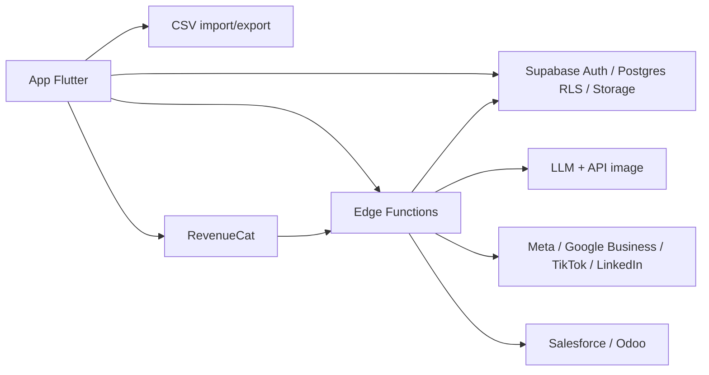

# Exigences

### Vue d'ensemble & objectifs
**Flyer** est une app Android/iOS (Flutter) vendue aux photographes événementiels (ex. séances photo animaux en magasin Zooplus) pour :
1. Créer un **event** (dates, horaires, nom, description, lieu/enseigne partenaire) et le profil **entreprise** du photographe.
2. Générer par **IA** les flyers et contenus (visuel, texte, légendes) adaptés à chaque plateforme.
3. **Publier automatiquement** l'event sur les réseaux/plateformes compatibles, avec par plateforme la liste des **besoins** (photos, vidéo, audio, texte) et leur état.
4. Gérer la **clientèle** (CRM léger) et la **synchroniser** avec Salesforce, Odoo ou CSV.
5. **Monétiser** (abonnement freemium) tout en permettant une gratuité totale via **code partenaire**.

Problème racine (insight terrain) : le magasin partenaire ne fait pas la pub promise et ne booke quasi personne la veille de l'event → le photographe doit reprendre la main sur sa communication et son remplissage.

### Périmètre
**Dans le périmètre (ce plan)**
- Dossier `docs/` : analyse Lean UX complète, personas simulés (fiches détaillées et scénarios), règles de sprint et préparation des sprints (backlog priorisé, sprint 0→4).
- Squelette Flutter : structure `lib/` par features, dépendances (Supabase, Riverpod, go_router, freezed…), routing, thème, modèles de domaine, écrans placeholder ; test widget mis à jour ; `README.md` réécrit.
- Config Supabase versionnée : schéma SQL initial (`supabase/migrations`), squelettes Edge Functions.

**Hors périmètre**
- Implémentation fonctionnelle réelle (auth, génération IA, OAuth réseaux sociaux, sync CRM, paiements) → sprints suivants.
- Génération d'images/photos de personas (remplacée par des fiches textuelles riches : identité, personnalité, contexte, frustrations, objectifs, citation, scénario d'usage).

### Personas simulés (résumé — détail dans `docs/02-personas.md`)
| Persona | Rôle | Douleur principale | Fonctions validées |
|---|---|---|---|
| **Camille, 34 ans** — photographe animalière indépendante (Zooplus, Maxi Zoo) | Utilisatrice primaire | Le magasin ne fait pas la pub, elle découvre la veille que 2 créneaux sur 30 sont réservés | Events, flyers IA, multi-publication, rappels J-7/J-2 |
| **Marc, 47 ans** — photographe famille/mariage multi-salons | Utilisateur primaire (pro établi) | Perd du temps à re-saisir sa clientèle et ses posts sur 5 réseaux | CRM, import CSV/Odoo, templates réutilisables, abonnement Pro |
| **Sophie, 29 ans** — responsable de magasin Zooplus | Utilisatrice secondaire / partenaire | N'a ni temps ni visuels pour relayer l'event en magasin et sur la page locale | Lien partagé « kit partenaire » (flyer imprimable + post prêt), checklist besoins |
| **Léa, 41 ans** — cliente propriétaire de 2 chats, membre de groupes Facebook locaux | Cliente finale | Découvre les events trop tard, veut réserver en 2 clics | Page publique d'event + CTA réservation, contact capturé dans le CRM |
| **Ahmed, 38 ans** — photographe « ambassadeur » avec code partenaire | Utilisateur primaire gratuit | Veut tester sans carte bancaire, prêt à faire des retours | Code partenaire → plan Gratuit illimité, feedback in-app |

### User stories (extraits des epics)
- En tant que photographe, je veux m'authentifier (email/mot de passe, Apple, Google) pour retrouver mes events sur tous mes appareils.
- En tant que photographe, je veux renseigner mon profil entreprise (nom, SIRET, logo, adresse, téléphone, site, réseaux, charte couleurs) pour qu'il alimente automatiquement les flyers.
- En tant que photographe, je veux créer un event (nom, description, plage de dates, plage horaire par jour, lieu, enseigne partenaire, tarifs, lien de réservation) pour générer mes supports.
- En tant que photographe, je veux que l'IA me propose plusieurs flyers et textes par plateforme pour choisir et éditer rapidement.
- En tant que photographe, je veux voir par plateforme (Instagram, Facebook, TikTok, LinkedIn, Google Business, groupes locaux, page magasin, affiche A4 imprimable) les besoins (photo/vidéo/audio/texte) et leur état (manquant/fourni/généré) pour ne rien oublier.
- En tant que photographe, je veux publier/programmer en un clic sur les plateformes connectées et obtenir un kit à partager avec le magasin.
- En tant que photographe, je veux gérer ma clientèle (fiche client, animaux, historique d'events, consentement RGPD) et l'importer/exporter en CSV ou la synchroniser avec Salesforce/Odoo.
- En tant qu'éditeur, je veux un modèle freemium (Gratuit / Pro / Studio) et des codes partenaires qui déverrouillent tout gratuitement.

### Exigences fonctionnelles clés
- Formulaire event avec validation (date fin ≥ début, horaires cohérents), brouillon sauvegardé.
- Matrice « Plateforme × Besoin » avec statut et aide IA pour générer le besoin manquant.
- Publication : adaptateurs par plateforme (Meta Graph API, LinkedIn, TikTok, Google Business Profile ; fallback « copier/partager » via share sheet natif).
- CRM : liste, recherche, tags, import CSV (mapping colonnes), connecteurs Salesforce & Odoo (OAuth / clé API) en synchro bidirectionnelle contacts.
- Monétisation : RevenueCat/in-app purchases (Apple/Google) ; quotas (events/mois, générations IA/mois, plateformes connectées) ; code partenaire = plan `partner` sans quota, sans paiement.

### Exigences non fonctionnelles
- RGPD : consentement clients, export/suppression, données en UE (région Supabase eu).
- Clés API IA et réseaux sociaux **jamais** dans l'app : uniquement dans les Edge Functions.
- Offline-first léger : brouillons d'event en cache local.
- Langue : FR par défaut, i18n prête (EN).

# Analyse Lean UX

### Méthode
Cycle Lean UX (Gothelf) : **Hypothèses → Outcomes → Personas → MVP/expériences → Mesure → Apprentissage**. Le livrable `docs/01-lean-ux-canvas.md` suit le Lean UX Canvas v2 (8 cases).

### Lean UX Canvas (synthèse)
1. **Problème business** : les photographes événementiels dépendent de partenaires (magasins) qui ne font pas la promotion ; les séances sont sous-remplies, le CA est imprévisible.
2. **Résultats business (outcomes)** : taux de remplissage des créneaux ≥ 70 % ; ≥ 3 plateformes publiées par event ; conversion Gratuit→Pro ≥ 8 % ; rétention M3 ≥ 40 %.
3. **Utilisateurs** : Camille, Marc, Ahmed (primaires) ; Sophie (partenaire) ; Léa (cliente finale).
4. **Résultats utilisateurs** : « je passe de 3 h à 15 min pour communiquer un event », « je sais la veille combien de personnes viennent », « le magasin a tout ce qu'il faut pour relayer ».
5. **Solutions** : création d'event guidée ; génération IA multi-format ; matrice besoins par plateforme ; kit partenaire partageable ; page publique + réservation ; CRM + sync ; rappels automatiques.
6. **Hypothèses** (format : *Nous croyons que [outcome] sera atteint si [persona] obtient [bénéfice] grâce à [fonctionnalité]*) — ex. H1 : la publication multi-plateforme en 1 clic augmente le remplissage ; H2 : le kit partenaire fait relayer le magasin ; H3 : le code partenaire génère des ambassadeurs et du bouche-à-oreille ; H4 : l'import CSV suffit à 80 % des photographes avant Salesforce/Odoo.
7. **Hypothèse la plus risquée à tester en premier** : H1/H2 — les photographes utilisent-ils réellement la publication automatique, et les magasins relaient-ils le kit ?
8. **Expérience minimale (MVP)** : Auth + profil entreprise + event + génération IA (texte + 1 visuel) + export/partage natif + kit partenaire. CRM et sync CRM en vague 2, monétisation en vague 3.

### Proto-personas → personas simulés
Chaque persona (`docs/02-personas.md`) contient : identité & photo-description, personnalité (traits, rapport au numérique), contexte pro, journée type, objectifs, frustrations, citation, outils actuels, **scénario d'usage avec Flyer**, et **fonctionnalités validées / rejetées**. Une **empathy map** et une **journey map** (Mermaid) sont fournies pour Camille (persona principal) et Sophie.

### Priorisation
Matrice valeur/effort et MoSCoW dans `docs/03-backlog-priorise.md` → Epics : E1 Auth & profil, E2 Events, E3 IA & flyers, E4 Besoins par plateforme & publication, E5 Kit partenaire & page publique, E6 CRM & sync, E7 Monétisation & codes partenaires, E8 Analytics/apprentissage.

### Métriques & apprentissage
Événements analytiques définis dès le squelette (`event_created`, `flyer_generated`, `publish_success`, `partner_kit_shared`, `booking_clicked`, `partner_code_redeemed`) ; revue d'hypothèses à chaque sprint review.

### Monétisation (`docs/05-monetisation.md`)
| Plan | Prix indicatif | Quotas |
|---|---|---|
| Gratuit | 0 € | 1 event/mois, 5 générations IA, 2 plateformes, 50 contacts, watermark |
| Pro | 19 €/mois | events illimités, 100 générations, toutes plateformes, 2 000 contacts, CSV |
| Studio | 49 €/mois | multi-utilisateurs, Salesforce/Odoo, white-label, priorité IA |
| Partenaire | 0 € via code | = Studio, durée paramétrable, feedback obligatoire, attribution/parrainage |

Sources complémentaires : commission sur réservations (optionnel), marketplace de templates, offre B2B enseignes (Zooplus) pour sponsoriser le plan de leurs photographes.

# Règles & Sprints

### Règles de sprint (`docs/04-regles-sprints.md`)
- **Cadence** : sprints de 2 semaines ; Sprint 0 de cadrage/outillage d'1 semaine.
- **Rituels** : planning (2 h), daily (15 min), review orientée **hypothèses** (démo + métriques), rétro (1 h), 1 session de test utilisateur avec ≥ 3 photographes par sprint.
- **Definition of Ready** : story liée à une hypothèse Lean UX + persona, critères d'acceptation Gherkin, maquette ou wireframe, estimation ≤ 8 pts.
- **Definition of Done** : code sur `main` via PR revue, `flutter analyze` sans erreur, tests unitaires/widgets verts, évènement analytique câblé, texte FR, feature derrière un flag si incomplète, doc mise à jour.
- **Règles produit** : chaque sprint livre une version testable (TestFlight / Internal testing) ; une hypothèse validée/invalidée par sprint minimum ; pas de clé API dans le client ; RGPD by design.
- **Conventions code** : architecture par features (`lib/features/<feature>/{data,domain,presentation}`), Riverpod pour l'état, freezed pour les modèles, go_router pour la navigation, lints `flutter_lints` + règles strictes.

### Préparation des sprints (`docs/06-preparation-sprints.md`)
| Sprint | Objectif / hypothèse | Contenu principal |
|---|---|---|
| **S0** (1 sem) | Outillage | Projet Supabase, CI (`flutter analyze`/`test`), squelette app (ce plan), schéma DB, design tokens, 5 interviews de photographes |
| **S1** | H0 : les photographes saisissent un event en < 5 min | Auth email/Apple/Google, profil entreprise, CRUD event, brouillon local |
| **S2** | H1 : la génération IA fait gagner du temps | Edge Function `generate-content` (LLM + image), 3 propositions de flyer, édition texte, export image, share sheet |
| **S3** | H2 : le kit partenaire fait relayer le magasin | Matrice plateforme × besoin, kit partenaire (PDF A4 + posts), page publique d'event + CTA réservation, rappels J-7/J-2 |
| **S4** | H1 bis : publication automatique | OAuth Meta (Instagram/Facebook), programmation, statut de publication, Google Business |
| **S5** | H4 : CRM léger suffisant | Fiches clients + animaux, tags, import/export CSV, consentement RGPD |
| **S6** | Monétisation | RevenueCat, plans & quotas, codes partenaires, écran paywall, analytics conversion |
| **S7** | Intégrations | Connecteurs Salesforce & Odoo (Edge Functions), TikTok/LinkedIn, multi-utilisateurs Studio |

Chaque sprint du document contient : objectif, hypothèse testée, stories (ID, persona, points), critères d'acceptation, métriques de succès, risques, plan de test utilisateur.

# Conception technique

### Implémentation actuelle
- Template Flutter vierge (Flutter 3.32.2 / Dart ^3.8.1) : `lib/main.dart` (compteur par défaut), `test/widget_test.dart`, `pubspec.yaml` sans dépendance métier, `analysis_options.yaml` avec `flutter_lints`.
- Plateformes présentes : `android/`, `ios/`, `web/`.

### Décisions clés
| Décision | Choix | Raison |
|---|---|---|
| Backend | **Supabase** (Auth, Postgres, Storage, Edge Functions, région EU) | Validé par l'utilisateur ; RGPD, coûts prévisibles, clés IA côté serveur |
| État | **flutter_riverpod** + `riverpod_annotation` | Testable, standard Flutter actuel |
| Navigation | **go_router** avec redirection auth | Deep links pour la page publique d'event |
| Modèles | **freezed** + `json_serializable` | Immutabilité, (dé)sérialisation Supabase |
| IA | Edge Function `generate-content` appelant un LLM (texte) et une API image ; le client n'appelle jamais l'IA directement | Sécurité des clés, quotas par plan |
| Publication | Edge Functions par plateforme (`publish-meta`, `publish-google`), fallback `share_plus` | OAuth serveur, tokens chiffrés en DB |
| CRM sync | Edge Functions `sync-salesforce`, `sync-odoo`, import CSV côté client (`csv`, `file_picker`) | Isolation des secrets, logique commune `crm_adapter` |
| Monétisation | **RevenueCat** (`purchases_flutter`) + table `subscriptions` + table `partner_codes` ; `plan` résolu côté serveur (RLS) | Un seul SDK Apple/Google, codes partenaires sans paiement |

### Structure de fichiers proposée
```
docs/
  00-vision.md
  01-lean-ux-canvas.md
  02-personas.md                 (5 personas simulés + empathy/journey maps Mermaid)
  03-backlog-priorise.md         (epics, stories, MoSCoW, matrice valeur/effort)
  04-regles-sprints.md           (cadence, rituels, DoR/DoD, conventions)
  05-monetisation.md             (plans, quotas, codes partenaires, B2B)
  06-preparation-sprints.md      (S0 → S7 détaillés)
  07-architecture.md             (schéma, flux, sécurité)
supabase/
  migrations/0001_init.sql       (profiles, businesses, events, event_schedules,
                                  platforms, event_platform_needs, publications,
                                  customers, pets, crm_connections, subscriptions,
                                  partner_codes, analytics_events + RLS)
  functions/
    generate-content/index.ts    (squelette)
    publish-meta/index.ts        (squelette)
    sync-crm/index.ts            (squelette)
    redeem-partner-code/index.ts (squelette)
lib/
  main.dart                      (init Supabase, ProviderScope, FlyerApp)
  app/
    app.dart                     (MaterialApp.router, thème)
    router.dart                  (go_router, routes + redirection auth)
    theme.dart
  core/
    supabase/supabase_client.dart
    analytics/analytics_service.dart (noms d'événements Lean UX)
    widgets/ (placeholders communs)
  features/
    auth/        {data,domain,presentation}  → LoginPage, SignUpPage
    business_profile/                        → BusinessProfilePage
    events/                                  → EventListPage, EventFormPage, Event model
    ai_content/                              → FlyerGeneratorPage (placeholder)
    publishing/                              → PlatformNeedsPage, Platform/Need enums
    partner_kit/                             → PartnerKitPage (placeholder)
    crm/                                     → CustomerListPage, Customer model
    billing/                                 → PaywallPage, Plan enum, PartnerCodePage
test/
  widget_test.dart               (remplacé : smoke test FlyerApp)
  features/events/event_model_test.dart
```

### Modèles de domaine (extraits)
```dart
@freezed class Event with _$Event {
  const factory Event({
    required String id, required String businessId,
    required String name, required String description,
    required DateTime startDate, required DateTime endDate,
    required List<DailySchedule> schedules, // jour → heure début/fin
    String? venueName, String? partnerStoreName, String? bookingUrl,
    @Default(EventStatus.draft) EventStatus status,
  }) = _Event;
}

enum Platform { instagram, facebook, tiktok, linkedin, googleBusiness, localGroups, storePage, printA4 }
enum NeedType { photo, video, audio, text }
enum NeedStatus { missing, provided, generated }

@freezed class PlatformNeed with _$PlatformNeed {
  const factory PlatformNeed({required Platform platform, required NeedType type,
    @Default(NeedStatus.missing) NeedStatus status, String? assetUrl}) = _PlatformNeed;
}

enum Plan { free, pro, studio, partner }
```

### Dépendances à ajouter (`pubspec.yaml`)
`supabase_flutter`, `flutter_riverpod`, `riverpod_annotation`, `go_router`, `freezed_annotation`, `json_annotation`, `intl`, `share_plus`, `file_picker`, `csv`, `purchases_flutter`, `flutter_dotenv` ; dev : `build_runner`, `freezed`, `json_serializable`, `riverpod_generator`, `mocktail`.

### Diagramme d'architecture


### Risques
- APIs réseaux sociaux (Meta App Review, TikTok) longues à obtenir → fallback share sheet + kit partenaire dès S2.
- Coût IA → quotas par plan appliqués dans l'Edge Function.
- `purchases_flutter` nécessite des comptes développeur Apple/Google → placeholder en S0, réel en S6.
- Génération de code (`build_runner`) : les fichiers `.g.dart`/`.freezed.dart` seront générés et vérifiés via `flutter analyze`.

# Validation

### Approche
- Documents : relecture de cohérence (chaque story ↔ hypothèse ↔ persona ; chaque sprint ↔ epic), Mermaid valide.
- Squelette : `flutter pub get`, `dart run build_runner build --delete-conflicting-outputs`, `flutter analyze` (0 erreur), `flutter test` verts.

### Scénarios clés
- L'app démarre sur un écran de connexion placeholder sans crash même si Supabase n'est pas configuré (URL/clé lues depuis `.env`, mode « non configuré » toléré).
- Navigation go_router vers chaque page placeholder (events, profil, besoins plateforme, CRM, paywall).
- Test unitaire : `Event` sérialise/désérialise en JSON ; validation `endDate >= startDate`.
- Test widget : smoke test `FlyerApp` remplaçant le test compteur.

### Cas limites
- Absence de fichier `.env` → message explicite, pas d'exception non gérée.
- Lints : aucune règle `flutter_lints` violée dans les nouveaux fichiers.

### Modifications de tests
- Remplacer `test/widget_test.dart` ; ajouter `test/features/events/event_model_test.dart`.

# Delivery Steps

### ✓ Step 1: Rédiger la vision, le Lean UX Canvas et les personas simulés
Le dossier `docs/` contient la vision produit, le Lean UX Canvas complet et 5 personas simulés validant les fonctionnalités.

- Créer `docs/00-vision.md` : problème terrain (magasins qui ne font pas la pub), proposition de valeur, cibles, principes produit.
- Créer `docs/01-lean-ux-canvas.md` : 8 cases du canvas, hypothèses H1–H6 au format Lean UX, hypothèse la plus risquée, MVP, métriques d'outcomes.
- Créer `docs/02-personas.md` : Camille, Marc, Sophie, Léa, Ahmed — identité, personnalité, contexte, journée type, objectifs, frustrations, citation, outils, scénario d'usage avec Flyer, fonctionnalités validées/rejetées.
- Ajouter empathy map et journey map Mermaid pour Camille et Sophie.

### ✓ Step 2: Rédiger le backlog priorisé, la monétisation et l'architecture
Le backlog, le modèle économique et l'architecture cible sont documentés et cohérents avec les personas.

- Créer `docs/03-backlog-priorise.md` : epics E1–E8, user stories (ID, persona, hypothèse, critères d'acceptation Gherkin, points), MoSCoW et matrice valeur/effort.
- Créer `docs/05-monetisation.md` : plans Gratuit/Pro/Studio/Partenaire, quotas, mécanisme de codes partenaires (génération, durée, attribution, feedback), offre B2B enseignes, options commission/templates.
- Créer `docs/07-architecture.md` : Flutter + Supabase + Edge Functions, flux IA, publication, sync CRM, sécurité (RLS, secrets), RGPD, diagrammes Mermaid.

### ✓ Step 3: Rédiger les règles de sprint et la préparation des sprints S0–S7
Les règles d'équipe et le plan détaillé des sprints liés aux hypothèses Lean UX sont prêts à l'usage.

- Créer `docs/04-regles-sprints.md` : cadence 2 semaines, rituels, review orientée hypothèses, DoR, DoD, règles produit, conventions de code Flutter (features, Riverpod, freezed, go_router).
- Créer `docs/06-preparation-sprints.md` : pour S0 à S7 — objectif, hypothèse testée, stories sélectionnées, critères d'acceptation, métriques de succès, risques, plan de test utilisateur.
- Vérifier la traçabilité story → hypothèse → persona → sprint.

### ✓ Step 4: Mettre en place le squelette Flutter (dépendances, routing, thème, core)
L'app démarre sur un écran de connexion placeholder avec navigation go_router et initialisation Supabase tolérante.

- Mettre à jour `pubspec.yaml` : supabase_flutter, flutter_riverpod, riverpod_annotation, go_router, freezed_annotation, json_annotation, intl, share_plus, file_picker, csv, purchases_flutter, flutter_dotenv + dev deps (build_runner, freezed, json_serializable, riverpod_generator, mocktail) ; déclarer `.env` en asset et créer `.env.example`.
- Réécrire `lib/main.dart` (chargement `.env`, init Supabase tolérante, `ProviderScope`) et créer `lib/app/app.dart`, `lib/app/router.dart`, `lib/app/theme.dart`.
- Créer `lib/core/supabase/supabase_client.dart`, `lib/core/analytics/analytics_service.dart` (événements Lean UX), widgets placeholder communs.
- Réécrire `README.md` (présentation, setup Supabase, commandes, lien vers `docs/`).

### ✓ Step 5: Créer les features placeholder et les modèles de domaine
Chaque epic a son dossier feature avec modèles freezed et pages placeholder navigables.

- `features/auth` : LoginPage, SignUpPage, provider d'état d'auth.
- `features/business_profile` : modèle BusinessProfile, BusinessProfilePage.
- `features/events` : modèles Event, DailySchedule, EventStatus avec validation de dates ; EventListPage, EventFormPage.
- `features/ai_content`, `features/publishing` (enums Platform/NeedType/NeedStatus, modèle PlatformNeed, PlatformNeedsPage), `features/partner_kit`, `features/crm` (Customer, Pet, CustomerListPage), `features/billing` (enum Plan, PaywallPage, PartnerCodePage).
- Exécuter `build_runner` pour générer les fichiers freezed/json ; `flutter analyze` sans erreur.

### ✓ Step 6: Versionner le schéma Supabase, les squelettes d'Edge Functions et les tests
Le schéma de données initial et les points d'entrée serveur existent, et la suite de tests passe.

- Créer `supabase/migrations/0001_init.sql` : tables profiles, businesses, events, event_schedules, platforms, event_platform_needs, publications, customers, pets, crm_connections, subscriptions, partner_codes, analytics_events + politiques RLS.
- Créer les squelettes `supabase/functions/{generate-content,publish-meta,sync-crm,redeem-partner-code}/index.ts` avec contrats d'entrée/sortie commentés.
- Remplacer `test/widget_test.dart` par un smoke test de `FlyerApp` ; ajouter `test/features/events/event_model_test.dart` (sérialisation, validation des dates).
- Lancer `flutter test` et `flutter analyze` pour valider l'ensemble.