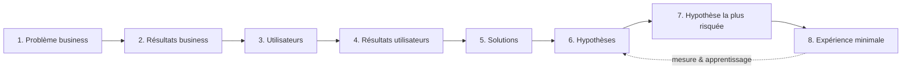

# Flyer — Lean UX Canvas (v2)

Méthode : cycle Lean UX de Jeff Gothelf — **Hypothèses → Outcomes → Personas → MVP / expériences → Mesure → Apprentissage**. Ce canvas est revu à chaque sprint review (voir [04-regles-sprints.md](04-regles-sprints.md)).

---

## Case 1 — Problème business

Les photographes événementiels (séances photo d'animaux en animalerie, studios éphémères en magasin, salons) dépendent de **partenaires qui ne font pas la promotion promise**. Résultat : des séances sous-remplies (souvent < 20 % des créneaux la veille), un chiffre d'affaires imprévisible, et 2 à 3 heures de communication improvisée la veille au soir sur plusieurs réseaux.

Les outils existants sont fragmentés : Canva pour le visuel, chaque réseau social séparément, un carnet ou un tableur pour les clients. Aucun ne part de **l'event** comme objet central ni ne donne au partenaire un kit prêt à relayer.

**Notre produit** doit permettre à un photographe de créer un event et d'en assurer la communication complète en moins de 15 minutes, sans dépendre du magasin, tout en lui facilitant la vie.

---

## Case 2 — Résultats business (outcomes)

| # | Outcome | Cible 12 mois | Indicateur avancé (leading) |
|---|---|---|---|
| B1 | Taux de remplissage des créneaux des events publiés via Flyer | ≥ 70 % | Clics sur « Réserver » par event |
| B2 | Nombre de plateformes publiées par event | ≥ 3 | `publish_success` / event |
| B3 | Conversion Gratuit → Pro | ≥ 8 % | Atteinte de quota (`quota_reached`) |
| B4 | Rétention à 3 mois des photographes actifs | ≥ 40 % | Events créés par mois / utilisateur |
| B5 | Taux de relais des kits partenaires par les magasins | ≥ 50 % | `partner_kit_opened` |
| B6 | Codes partenaires → ambassadeurs actifs | ≥ 60 % des codes utilisés créent ≥ 2 events | `partner_code_redeemed` + feedback |

---

## Case 3 — Utilisateurs

Détails dans [02-personas.md](02-personas.md).

| Persona | Type | Rôle vis-à-vis de Flyer |
|---|---|---|
| **Camille** (34) — photographe animalière en magasin | Primaire | Cœur de cible, crée les events, publie, envoie le kit |
| **Marc** (47) — photographe multi-salons établi | Primaire | Utilisateur Pro, CRM & import, templates |
| **Ahmed** (38) — photographe ambassadeur | Primaire (gratuit) | Code partenaire, feedback intensif |
| **Sophie** (29) — responsable de magasin Zooplus | Secondaire | Reçoit le kit partenaire, relaie |
| **Léa** (41) — cliente propriétaire de chats | Finale | Voit la page publique, réserve |

---

## Case 4 — Résultats utilisateurs (user outcomes)

Ce que les utilisateurs veulent *réellement* obtenir (pas des fonctionnalités) :

- **Camille** : « Je passe de 3 h la veille à 15 min la semaine d'avant, et je sais la veille combien de personnes viennent. »
- **Marc** : « Je ne ressaisis plus jamais mes clients ni mes posts, mes 5 réseaux sont alimentés depuis un seul endroit. »
- **Ahmed** : « Je teste tout sans sortir ma carte bancaire et je sens que mes retours comptent. »
- **Sophie** : « J'ai une affiche à imprimer et un post à copier-coller en 2 minutes, sans avoir à créer quoi que ce soit. »
- **Léa** : « Je découvre l'event à temps et je réserve en 2 clics depuis mon téléphone. »

Émotion recherchée : **soulagement et contrôle** (« ce n'est plus le magasin qui décide si ma journée sera remplie »).

---

## Case 5 — Solutions

| Solution | Résultat utilisateur servi | Personas |
|---|---|---|
| S1. Création d'event guidée (dates, horaires par jour, lieu, enseigne, tarifs, lien de réservation) pré-remplie depuis le profil entreprise | Event en 5 min | Camille, Marc, Ahmed |
| S2. Génération IA multi-format (visuel + texte + légendes par plateforme), 3 propositions, édition rapide | Communication en 15 min | Camille, Marc |
| S3. Matrice **plateforme × besoin** (photo / vidéo / audio / texte) avec statut manquant / fourni / généré | Rien n'est oublié | Camille, Marc |
| S4. Publication 1 clic sur plateformes connectées (Meta, Google Business, puis TikTok/LinkedIn) ; fallback share sheet natif | Multi-réseaux sans ressaisie | Camille, Marc |
| S5. **Kit partenaire** : lien partageable avec affiche A4 PDF + posts prêts + checklist | Le magasin relaie sans effort | Camille → Sophie |
| S6. Page publique d'event + CTA réservation, contacts captés dans le CRM | Réservation en 2 clics | Léa → Camille |
| S7. CRM léger (clients, animaux, historique, consentement) + import/export CSV + sync Salesforce / Odoo | Plus de ressaisie | Marc, Camille |
| S8. Rappels automatiques J-7 / J-2 (relance publication, relance magasin) | Savoir à l'avance | Camille |
| S9. Freemium + codes partenaires | Tester gratuitement, monétiser | Ahmed, éditeur |

---

## Case 6 — Hypothèses

Format Lean UX : *Nous croyons que **[outcome business]** sera atteint si **[persona]** obtient **[résultat utilisateur]** grâce à **[fonctionnalité]**.*

| ID | Hypothèse | Outcome | Solution | Sprint de test |
|---|---|---|---|---|
| **H0** | Nous croyons que la **rétention (B4)** sera atteinte si **Camille** peut **saisir un event complet en < 5 min** grâce à la **création guidée pré-remplie par le profil entreprise (S1)**. | B4 | S1 | S1 |
| **H1** | Nous croyons que le **remplissage ≥ 70 % (B1)** et **≥ 3 plateformes/event (B2)** seront atteints si **Camille** peut **communiquer un event en 15 min sur tous ses réseaux** grâce à la **génération IA (S2)** et à la **publication 1 clic (S4)**. | B1, B2 | S2, S4 | S2 (IA), S4 (publication) |
| **H2** | Nous croyons que le **taux de relais magasin ≥ 50 % (B5)** sera atteint si **Sophie** reçoit **un kit prêt à imprimer et à poster en 2 min** grâce au **kit partenaire (S5)**. | B5 | S5 | S3 |
| **H3** | Nous croyons que **≥ 60 % des codes créent des ambassadeurs actifs (B6)** si **Ahmed** peut **utiliser toutes les fonctions sans carte bancaire** grâce au **code partenaire (S9)** en échange de **feedback in-app**. | B6 | S9 | S6 |
| **H4** | Nous croyons que la **rétention de Marc (B4)** sera atteinte si **l'import/export CSV (S7)** couvre **80 % des besoins de synchronisation** avant toute intégration Salesforce/Odoo. | B4 | S7 | S5 |
| **H5** | Nous croyons que la **conversion Gratuit → Pro ≥ 8 % (B3)** sera atteinte si **Camille** atteint **naturellement ses quotas après 1 event réussi** grâce aux **plans et paywall contextuel (S9)**. | B3 | S9 | S6 |
| **H6** | Nous croyons que le **remplissage (B1)** augmentera si **Léa** peut **réserver en 2 clics** depuis une **page publique mobile avec CTA (S6)**, et si **Camille** reçoit des **rappels J-7 / J-2 (S8)**. | B1 | S6, S8 | S3 |

---

## Case 7 — Hypothèse la plus risquée (à tester en premier)

**H1 et H2**, car si elles sont fausses, le produit n'a pas de raison d'être :

1. **H1** — Les photographes utilisent-ils réellement la génération IA puis la publication multi-plateforme, ou préfèrent-ils continuer avec Canva + copier-coller ? Risque : qualité IA insuffisante, méfiance, APIs réseaux sociaux difficiles à obtenir.
2. **H2** — Les magasins relaient-ils réellement quand on leur donne un kit prêt à l'emploi, ou le problème est-il plus profond (désintérêt) ? Risque : le kit est ouvert mais pas imprimé/posté.

**Pourquoi d'abord** : elles portent directement l'outcome principal (remplissage) ; elles sont testables rapidement avec un MVP (export image + share sheet + lien de kit) sans attendre les validations d'API Meta.

---

## Case 8 — Expérience minimale (MVP) & apprentissage

### MVP (sprints 1 à 3)

- Auth + profil entreprise.
- Création d'event (S1).
- Génération IA : 3 textes + 1 visuel par event (S2), export image + share sheet natif (pas encore d'OAuth).
- Matrice plateforme × besoin en lecture (S3).
- Kit partenaire : lien public avec PDF A4 + posts (S5).
- Page publique d'event + CTA (S6) ; rappels J-7 / J-2 (S8).

Hors MVP : publication OAuth (S4, sprint 4), CRM (S7, sprint 5), monétisation (S9, sprint 6), Salesforce/Odoo (sprint 7).

### Ce que nous devons apprendre, et comment

| Hypothèse | Expérience | Métrique de validation | Seuil « validée » |
|---|---|---|---|
| H0 | 5 photographes créent un event en test modéré | Temps chronométré | Médiane < 5 min |
| H1 (IA) | Les testeurs génèrent et publient (share sheet) un event réel | `flyer_generated`, `share_sheet_opened`, satisfaction 1-5 | ≥ 80 % publient ≥ 1 contenu généré ; satisfaction ≥ 4 |
| H2 | Les testeurs envoient le kit à un vrai magasin | `partner_kit_shared`, `partner_kit_opened`, relais constaté (photo de l'affiche en magasin) | ≥ 50 % des kits ouverts, ≥ 30 % relayés |
| H6 | Page publique sur 5 events réels | `booking_clicked` / vues | CTR ≥ 10 % |
| H1 bis (publication) | OAuth Meta sur 10 events | `publish_success` / tentatives | ≥ 90 % de succès, ≥ 3 plateformes/event |
| H4 | Import CSV auprès de 5 photographes | Imports réussis, demandes Salesforce/Odoo | ≥ 80 % satisfaits du CSV seul |
| H3, H5 | Codes partenaires + paywall en bêta | `partner_code_redeemed`, conversion | ≥ 60 % ambassadeurs actifs ; conversion ≥ 8 % |

### Événements analytiques (câblés dès le squelette)

`sign_up`, `business_profile_completed`, `event_created`, `flyer_generated`, `need_marked_provided`, `share_sheet_opened`, `publish_success`, `publish_failed`, `partner_kit_shared`, `partner_kit_opened`, `booking_clicked`, `customer_imported`, `crm_synced`, `quota_reached`, `paywall_viewed`, `subscription_started`, `partner_code_redeemed`, `feedback_submitted`.

---

## Revue du canvas

À chaque sprint review : pour chaque hypothèse testée, statut **Validée / Invalidée / À poursuivre**, décision **Persévérer / Pivoter / Abandonner**, et mise à jour des cases 5 à 8.
