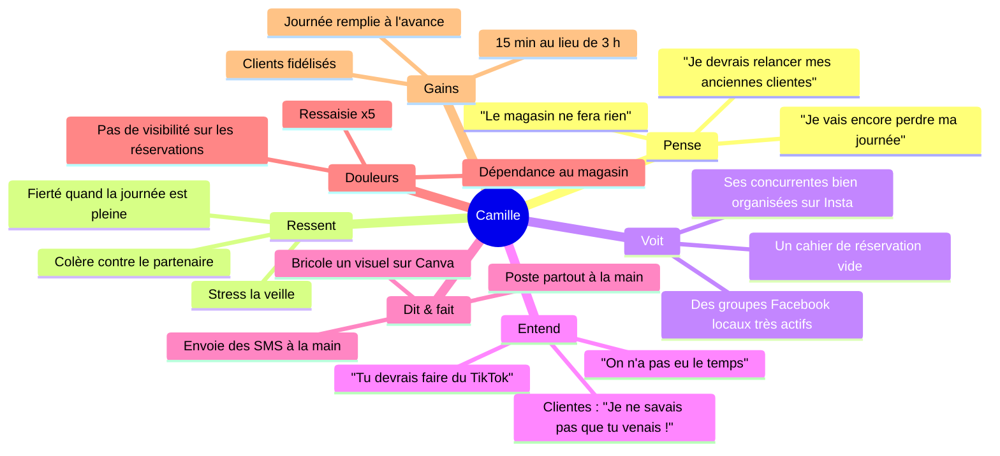
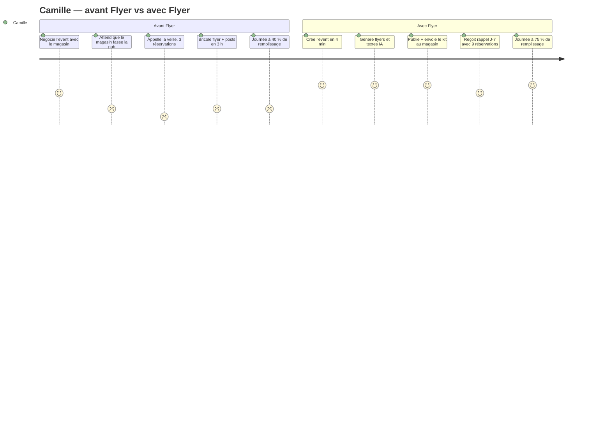
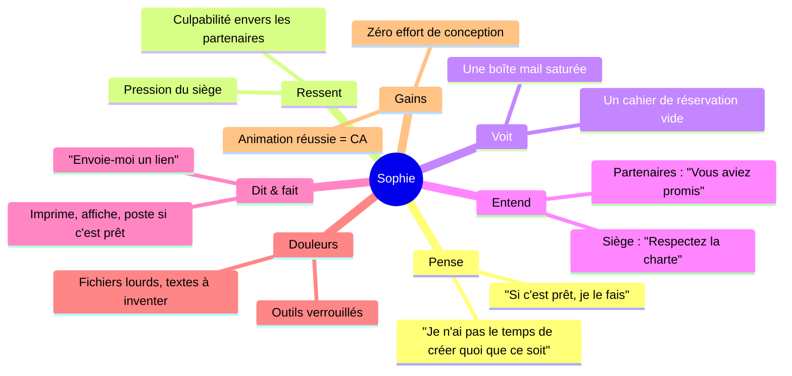
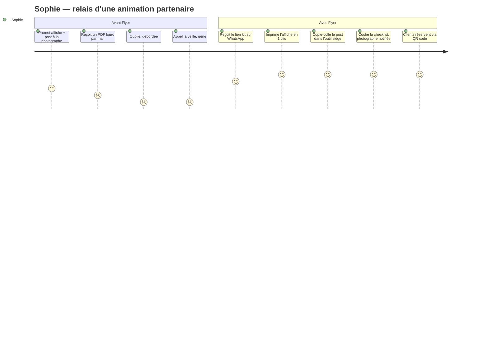

# Flyer — Personas simulés

> Ces personas sont **simulés** (proto-personas Lean UX) : des personnalités inventées, suffisamment détaillées pour valider ou rejeter les fonctionnalités avant les vrais entretiens terrain (Sprint 0). Chaque fiche se termine par les **fonctionnalités validées / rejetées** par le persona. Ils seront confrontés aux 5 interviews prévues en Sprint 0 et mis à jour.

| Persona | Âge | Rôle | Type | Hypothèses portées |
|---|---|---|---|---|
| [Camille Roux](#1-camille-roux--la-photographe-animalière-indépendante) | 34 | Photographe animalière en magasin | Primaire ⭐ | H0, H1, H2, H5, H6 |
| [Marc Delorme](#2-marc-delorme--le-photographe-établi-multi-salons) | 47 | Photographe famille / salons | Primaire | H1, H4 |
| [Sophie Nguyen](#3-sophie-nguyen--la-responsable-de-magasin) | 29 | Responsable de magasin Zooplus | Secondaire (partenaire) | H2 |
| [Léa Martin](#4-léa-martin--la-cliente-finale) | 41 | Cliente, 2 chats | Finale | H6 |
| [Ahmed Benali](#5-ahmed-benali--le-photographe-ambassadeur) | 38 | Photographe ambassadeur | Primaire (gratuit) | H3 |

---

## 1. Camille Roux — la photographe animalière indépendante

### Identité
- **34 ans**, vit à Villeurbanne (69), en couple, un border collie nommé Pixel.
- **Description visuelle** : cheveux châtains attachés, sweat à capuche avec son logo « Pattes & Pixels », toujours un sac photo en bandoulière et un téléphone à la main avec la coque fissurée.
- Photographe animalière indépendante depuis 4 ans (micro-entreprise), après 8 ans comme vendeuse en animalerie.
- CA ≈ 2 200 €/mois, très variable : entre 900 € et 3 800 € selon le remplissage des séances.

### Personnalité
- **Traits** : chaleureuse, débrouillarde, perfectionniste sur ses photos, allergique à l'administratif.
- **Rapport au numérique** : à l'aise avec Instagram et Canva, utilise Google Agenda, n'a jamais touché à un CRM. Fait tout depuis son iPhone 13, le Mac reste pour la retouche.
- **Valeurs** : bien-être animal, relation humaine, indépendance.
- **Ce qui l'énerve** : les promesses non tenues, les outils « usine à gaz », saisir deux fois la même information.

### Contexte professionnel
- 3 à 4 **journées en magasin par mois** (Zooplus Lyon-Part-Dieu, Maxi Zoo Vénissieux, une clinique vétérinaire) + séances à domicile.
- Une journée en magasin = ~30 créneaux de 15 minutes, 25 € le créneau avec 1 tirage offert, upsell de tirages et calendriers.
- **Deal avec le magasin** : le magasin fait la pub (affiche, page Facebook locale, bouche-à-oreille en caisse) et prend les réservations sur un cahier.
- **Réalité** : la veille au soir, 2 à 6 créneaux réservés sur 30.

### Journée type (J-1 d'un event)
- 8 h : séance photo à domicile (chat sénior).
- 11 h : retouches, Instagram stories.
- 14 h : appelle le magasin → « ah, on n'a pas eu le temps pour l'affiche, et il y a 3 réservations ».
- 14 h 30 – 17 h 30 : **panique** — ouvre Canva, bricole un visuel, poste sur Instagram, Facebook perso, 3 groupes Facebook « Animaux Lyon », envoie des SMS à ses anciennes clientes retrouvées dans ses conversations WhatsApp.
- 20 h : relance le magasin pour qu'ils partagent son post.
- Jour J : 12 créneaux remplis, dont 7 grâce à ses SMS.

### Objectifs
1. Remplir ≥ 70 % des créneaux **avant** la veille.
2. Passer moins de 15 minutes par event sur la communication.
3. Ne plus dépendre de la bonne volonté du magasin.
4. Garder le contact avec ses clientes (rappel annuel, calendrier de Noël).

### Frustrations
- « Le magasin ne fait jamais ce qu'il promet. »
- Réécrire le même texte 5 fois pour 5 plateformes.
- Ne pas savoir qui est venu à quel event (les noms sont dans le cahier du magasin).
- Les outils pros (Salesforce, HubSpot) sont hors de prix et incompréhensibles.

### Citation
> « Je ne demande pas la lune : un flyer, un post par réseau, et savoir la veille combien de personnes viennent. »

### Outils actuels
Canva (gratuit), Instagram, Facebook (profil + groupes), WhatsApp, Google Agenda, Notes iPhone, cahier du magasin.

### Scénario d'usage avec Flyer
1. **J-14** : Camille crée l'event « Séance photo de Noël — Zooplus Part-Dieu », 14 décembre, 10 h–18 h, 25 €, lien de réservation Calendly. Le profil entreprise (logo, couleurs, tel, Insta) est déjà rempli. **4 minutes.**
2. Elle lance la génération IA : 3 visuels + textes déclinés Instagram / Facebook / groupes locaux / affiche A4. Elle choisit, corrige une phrase. **6 minutes.**
3. La matrice **plateforme × besoin** lui montre qu'il manque une vidéo courte pour TikTok : elle marque « plus tard ».
4. Elle publie sur Instagram + Facebook en 1 clic (ou share sheet), et envoie le **lien kit partenaire** à Sophie par WhatsApp. **3 minutes.**
5. **J-7** : rappel Flyer « 9 réservations · relancer le magasin ? ». Elle voit que Sophie a ouvert le kit.
6. **J-2** : rappel + stats de la page publique (120 vues, 18 clics « Réserver »). Elle sait qu'elle aura ≥ 20 créneaux.
7. **J+1** : les 22 clients de la journée sont dans son CRM avec leurs animaux, consentement coché pour la relance de Noël prochain.

### Fonctionnalités validées ✅ / rejetées ❌
| Fonction | Verdict | Pourquoi |
|---|---|---|
| Création d'event guidée pré-remplie | ✅ Validée | « 4 minutes, c'est ce qu'il me faut. » |
| Génération IA multi-format | ✅ Validée | « Tant que je peux corriger le texte, ça me va. » |
| Matrice plateforme × besoin | ✅ Validée | « Je n'oublie plus TikTok ou l'affiche. » |
| Kit partenaire | ✅ Validée | « Comme ça ils n'ont plus d'excuse. » |
| Page publique + réservation | ✅ Validée | « Si ça remplace le cahier du magasin, je signe. » |
| Rappels J-7 / J-2 | ✅ Validée | « C'est exactement le moment où je panique. » |
| CRM léger | ✅ Validée (vague 2) | « Utile pour Noël, pas urgent. » |
| Sync Salesforce / Odoo | ❌ Rejetée (pour elle) | « Je ne sais même pas ce que c'est. » → CSV suffit (H4). |
| Publication automatique sans validation | ❌ Rejetée | « Je veux relire avant que ça parte. » |
| Édition avancée de visuel dans l'app | ❌ Rejetée | « Pour ça j'ai Canva, ne refaites pas Canva. » |

### Empathy map — Camille

### Journey map — Camille (event en magasin)

---

## 2. Marc Delorme — le photographe établi multi-salons

### Identité
- **47 ans**, Nantes, marié, deux ados. Studio « Delorme Photographie » depuis 19 ans, 1 assistante à mi-temps.
- **Description visuelle** : barbe grise soignée, chemise bleue, montre connectée, tablette Android et téléphone Samsung, agenda papier Moleskine en plus.
- CA ≈ 9 000 €/mois : mariages, portraits de famille, studios éphémères dans des centres commerciaux et salons (Salon du bébé, Salon du mariage), photos scolaires.

### Personnalité
- **Traits** : méthodique, exigeant, pragmatique, un peu sceptique vis-à-vis des « gadgets IA ».
- **Rapport au numérique** : avancé — utilise Odoo (facturation + contacts, ~1 800 fiches), Lightroom, Meta Business Suite, LinkedIn. Déteste les outils qui ne s'intègrent pas à l'existant.
- **Valeurs** : qualité, réputation locale, efficacité.

### Contexte professionnel
- 6 à 8 **events par mois** sur 5 réseaux (Instagram, Facebook pro, LinkedIn, Google Business, newsletter).
- Chaque event → le même rituel : post Instagram, adaptation Facebook, version LinkedIn plus sobre, fiche Google Business, ajout des nouveaux clients dans Odoo à la main le dimanche soir.
- Travaille déjà avec des galeries marchandes qui, elles aussi, « oublient » de relayer.

### Journée type
- 7 h : mails, planning de l'assistante.
- 9 h – 17 h : séances / mariage.
- 21 h : « l'heure des réseaux » — 45 minutes de copier-coller entre plateformes, 30 minutes de saisie de contacts.

### Objectifs
1. Un seul endroit pour écrire, décliner et publier.
2. Que les clients captés en event arrivent **dans Odoo** sans ressaisie.
3. Réutiliser ses templates (charte, ton, hashtags) d'un event à l'autre.
4. Un abonnement pro qu'il peut justifier comptablement.

### Frustrations
- La ressaisie (« je paye déjà Odoo, je ne vais pas tenir un second fichier »).
- Les générateurs IA qui produisent un ton « influenceur » ridicule pour LinkedIn.
- Les apps qui n'ont pas d'export : « mes données m'appartiennent ».

### Citation
> « Si ça ne parle pas à Odoo et que ça n'exporte pas en CSV, je n'installe même pas. »

### Outils actuels
Odoo (CRM + facturation), Meta Business Suite, LinkedIn, Lightroom, Canva Pro, Mailchimp, Google Sheets.

### Scénario d'usage avec Flyer
1. Importe ses 1 800 contacts via **CSV** depuis Odoo (mapping colonnes : nom, email, tel, tags).
2. Crée un template d'event « Studio éphémère — centre commercial » avec son ton (« élégant, sobre, pas d'emoji sur LinkedIn »).
3. Pour chaque nouvel event, duplique le template, ajuste dates/lieu, génère les déclinaisons par plateforme, publie via les connexions Meta + LinkedIn + Google Business.
4. Les contacts captés via la page publique sont taggés `event-2026-03` et **synchronisés vers Odoo** (plan Studio) ou exportés en CSV (plan Pro).
5. Souscrit au plan **Pro** (19 €) dès le premier mois, passe en **Studio** quand le connecteur Odoo est disponible.

### Fonctionnalités validées ✅ / rejetées ❌
| Fonction | Verdict | Pourquoi |
|---|---|---|
| Import / export CSV | ✅ Validée (indispensable) | Condition d'installation. |
| Connecteur Odoo bidirectionnel | ✅ Validée (plan Studio) | « C'est ce qui justifie 49 €. » |
| Templates d'event réutilisables & ton par plateforme | ✅ Validée | Évite le ton « influenceur ». |
| Publication 1 clic multi-plateforme, dont LinkedIn et Google Business | ✅ Validée | Son principal gain de temps. |
| Programmation des publications | ✅ Validée | Publie à 21 h sans être devant l'écran. |
| Kit partenaire | ✅ Validée (secondaire) | Utile pour les galeries marchandes. |
| Connecteur Salesforce | ❌ Non pertinent pour lui | Mais il « connaît des studios qui l'utilisent ». |
| Watermark du plan Gratuit | ❌ Rejetée | « Jamais de watermark sur mon travail » → passe en Pro. |
| TikTok | ❌ Rejetée | Pas sa clientèle. |

---

## 3. Sophie Nguyen — la responsable de magasin

### Identité
- **29 ans**, responsable adjointe du Zooplus de Lyon Part-Dieu depuis 2 ans, 6 personnes en équipe.
- **Description visuelle** : polo de l'enseigne, badge, talkie-walkie à la ceinture, téléphone pro Android verrouillé par la DSI, imprimante de la réserve capricieuse.
- Évaluée sur le CA, la casse et la satisfaction client — **pas** sur le succès des animations.

### Personnalité
- **Traits** : organisée mais débordée, bienveillante, pragmatique : « si ça prend 2 minutes, je le fais ; si ça en prend 20, ça attendra… et ça n'arrivera pas ».
- **Rapport au numérique** : usage perso d'Instagram/TikTok, mais les outils pro sont verrouillés. Elle peut poster sur la page Facebook locale du magasin via l'outil siège, imprimer en A4, et afficher en vitrine/caisse.

### Contexte professionnel
- Reçoit chaque mois 3 à 5 demandes d'animation (photographe, éducateur canin, marques de croquettes).
- Ce qu'elle promet sincèrement : affiche, post Facebook, mot en caisse. Ce qu'elle fait réellement : rien, faute d'un visuel prêt et d'un moment calme.
- Le cahier de réservation est à l'accueil ; personne ne le remplit.

### Journée type
- 8 h 30 : ouverture, mise en rayon, inventaire des vivants.
- 12 h : pic de clientèle, caisse.
- 15 h : réunion siège en visio, reporting.
- 17 h : Camille appelle pour la séance de demain… « ah mince ».

### Objectifs
1. Faire plaisir à ses partenaires **sans effort** ni risque vis-à-vis du siège.
2. Avoir une animation qui attire du monde en magasin (= CA additionnel).
3. Ne rien avoir à concevoir : « donnez-moi le truc à imprimer et le texte à coller ».

### Frustrations
- Les partenaires qui envoient un PDF 40 Mo en pièce jointe sur sa boîte pro saturée.
- Devoir inventer un texte de post.
- Gérer un cahier de réservation papier.

### Citation
> « Envoie-moi un lien avec l'affiche et le texte du post, je m'en occupe entre deux clients. »

### Outils actuels
Outil siège de publication Facebook, imprimante A4, WhatsApp perso avec les partenaires, cahier papier.

### Scénario d'usage avec Flyer (sans compte)
1. Reçoit un lien WhatsApp de Camille : **kit partenaire** « Séance photo de Noël — 14 déc. ».
2. Ouvre la page mobile : affiche A4 PDF (bouton « Imprimer »), post Facebook prêt (bouton « Copier le texte » + image à télécharger), texte court pour l'annonce caisse, QR code vers la page de réservation, checklist en 3 cases (☐ Affiche imprimée ☐ Post publié ☐ Équipe prévenue).
3. Coche les cases → Camille est notifiée (`partner_kit_opened`, `partner_kit_checked`).
4. Les clients scannent le QR en caisse et réservent eux-mêmes : plus de cahier.

### Fonctionnalités validées ✅ / rejetées ❌
| Fonction | Verdict | Pourquoi |
|---|---|---|
| Kit partenaire via simple lien, sans compte | ✅ Validée | Condition absolue : zéro inscription. |
| PDF A4 prêt à imprimer + QR code | ✅ Validée | « 2 minutes, je le fais tout de suite. » |
| Texte de post à copier + image à télécharger | ✅ Validée | Compatible avec l'outil siège. |
| Checklist de relais avec notification à la photographe | ✅ Validée | « Ça me déculpabilise et ça la rassure. » |
| Page publique de réservation | ✅ Validée | Remplace le cahier. |
| Création de compte magasin / app dédiée | ❌ Rejetée | Téléphone pro verrouillé, pas le temps. |
| Publication automatique sur la page du magasin via OAuth | ❌ Rejetée (hors de son pouvoir) | Les accès appartiennent au siège → à adresser en offre B2B enseigne. |

### Empathy map — Sophie

### Journey map — Sophie (relais d'un event)

---

## 4. Léa Martin — la cliente finale

### Identité
- **41 ans**, Lyon 3e, cadre RH, maman d'un garçon de 9 ans, propriétaire de deux chats (Mochi et Nala).
- **Description visuelle** : trench, AirPods, iPhone toujours en main dans le métro, fond d'écran = ses chats.
- Membre de 3 groupes Facebook (« Chats de Lyon », « Bons plans Lyon 3 », groupe de parents d'élèves), suit des comptes animaliers sur Instagram.

### Personnalité
- **Traits** : affective avec ses animaux, pressée, impulsive sur les « bons plans », exigeante sur la simplicité.
- **Rapport au numérique** : réserve tout en ligne (médecin, restaurant), abandonne si un formulaire dépasse 4 champs ou demande de créer un compte.

### Contexte
- Veut de belles photos de ses chats pour un calendrier de Noël offert aux grands-parents.
- Fait ses courses chez Zooplus le samedi matin.
- A déjà raté deux séances « parce que je l'ai vu après ».

### Objectifs
1. Être informée **à temps** (≥ 1 semaine avant).
2. Réserver un créneau en 2 clics, depuis le téléphone, sans compte.
3. Recevoir un rappel la veille.

### Frustrations
- Les posts d'event sans date lisible ni lien de réservation.
- Devoir appeler le magasin aux heures d'ouverture.
- Les formulaires interminables.

### Citation
> « Si je dois téléphoner pour réserver, c'est mort. Un lien, un créneau, c'est tout. »

### Scénario d'usage avec Flyer
1. Voit dans « Chats de Lyon » le post de Camille (généré par Flyer) : visuel clair, date, « Réserver → lien ».
2. Ouvre la **page publique d'event** : résumé, tarif, créneaux disponibles, bouton « Réserver » (vers Calendly de Camille ou formulaire 3 champs : nom, tel, animal).
3. Accepte (case non pré-cochée) d'être recontactée pour les prochaines séances → entre dans le CRM de Camille avec Mochi et Nala.
4. Reçoit un SMS/e-mail de rappel la veille.

### Fonctionnalités validées ✅ / rejetées ❌
| Fonction | Verdict | Pourquoi |
|---|---|---|
| Page publique mobile claire (date, lieu, prix, CTA) | ✅ Validée | C'est ce qui lui manquait. |
| Réservation ≤ 3 champs, sans compte | ✅ Validée | Seuil d'abandon connu. |
| Consentement RGPD explicite et simple | ✅ Validée | Elle accepte si c'est clair et désactivable. |
| Rappel la veille | ✅ Validée | Évite les no-shows. |
| Visuels générés par IA | ✅ Validée (indifférente) | Tant que c'est lisible et pas « cheap ». |
| Création de compte client | ❌ Rejetée | Abandon immédiat. |
| App à installer pour réserver | ❌ Rejetée | Jamais pour un achat ponctuel. |

---

## 5. Ahmed Benali — le photographe ambassadeur

### Identité
- **38 ans**, Toulouse, photographe événementiel (animaux + sport canin : agility, canicross) depuis 6 ans, très actif sur Instagram (12 k abonnés) et YouTube (tutos photo).
- **Description visuelle** : casquette, veste technique, appareil hybride sur sangle, Pixel 8 avec 40 applis bêta installées.
- Connaît une vingtaine de photographes animaliers en France via un groupe Discord qu'il anime.

### Personnalité
- **Traits** : curieux, early adopter, généreux en retours, direct (« ça, c'est nul »), motivé par la reconnaissance et l'influence sur le produit.
- **Rapport au numérique** : expert ; teste tout, mais **refuse de donner sa carte bancaire pour un essai**.

### Contexte professionnel
- 2 à 3 events/mois en magasin ou sur des concours canins ; les organisateurs communiquent aussi mal que les magasins.
- A été approché pour devenir **ambassadeur Flyer** : code partenaire → plan complet gratuit, en échange de feedback régulier et de bouche-à-oreille.

### Objectifs
1. Tester **toutes** les fonctionnalités gratuitement, sans limite ni watermark.
2. Avoir un canal de feedback direct et voir ses retours pris en compte.
3. Faire gagner du temps à sa communauté (et en tirer de la crédibilité : code de parrainage).

### Frustrations
- Les « essais gratuits 7 jours avec CB ».
- Les feedbacks envoyés dans le vide.
- Les apps qui bugguent sur Android.

### Citation
> « Donnez-moi un code, je teste tout, je vous dis tout — et si c'est bien, mes 20 potes photographes suivent. »

### Scénario d'usage avec Flyer
1. Saisit le code `AMB-AHMED-2026` à l'inscription → plan **Partenaire** (= Studio, 12 mois, sans paiement).
2. Utilise l'app sur ses events réels, en particulier la publication multi-plateforme et TikTok.
3. Chaque mois, un **formulaire de feedback in-app** (3 questions + champ libre) lui est proposé ; il peut aussi « signaler » depuis n'importe quel écran.
4. Partage son code de parrainage sur Discord : les filleuls obtiennent 1 mois Pro offert, lui prolonge son plan Partenaire.
5. Il figure dans la liste des ambassadeurs sur le site.

### Fonctionnalités validées ✅ / rejetées ❌
| Fonction | Verdict | Pourquoi |
|---|---|---|
| Code partenaire → plan complet sans CB | ✅ Validée | Condition absolue. |
| Feedback in-app + signalement contextuel | ✅ Validée | « Sinon je n'écris pas. » |
| Parrainage avec avantages | ✅ Validée | Motivation + mécanique d'acquisition (H3). |
| Publication TikTok / Reels | ✅ Validée | Son canal principal. |
| Toutes les fonctions Studio | ✅ Validée | Pour tester en conditions réelles. |
| Feedback obligatoire bloquant | ❌ Rejetée | Il veut une sollicitation douce, pas un blocage. |
| Code limité dans le temps sans prolongation | ❌ Rejetée | « Si je contribue, je garde l'accès. » |

---

## Synthèse : fonctionnalités validées par les personas

| Fonctionnalité | Camille | Marc | Sophie | Léa | Ahmed | Verdict global |
|---|---|---|---|---|---|---|
| Création d'event guidée | ✅ | ✅ | – | – | ✅ | **MVP** |
| Génération IA multi-format | ✅ | ✅ (ton par plateforme) | – | ✅ | ✅ | **MVP** |
| Matrice plateforme × besoin | ✅ | ✅ | – | – | ✅ | **MVP** |
| Kit partenaire sans compte | ✅ | ✅ | ✅ | – | ✅ | **MVP** |
| Page publique + réservation ≤ 3 champs | ✅ | ✅ | ✅ | ✅ | ✅ | **MVP** |
| Rappels J-7 / J-2 (photographe) + J-1 (client) | ✅ | ✅ | – | ✅ | ✅ | **MVP** |
| Publication 1 clic OAuth + programmation | ✅ | ✅ | ❌ (siège) | – | ✅ | Vague 2 (S4) |
| CRM léger + CSV | ✅ | ✅ | – | ✅ (consentement) | ✅ | Vague 2 (S5) |
| Codes partenaires, parrainage, feedback in-app | – | – | – | – | ✅ | Vague 3 (S6) |
| Plans & paywall | ✅ (Gratuit→Pro) | ✅ (Pro→Studio) | – | – | – | Vague 3 (S6) |
| Sync Salesforce / Odoo | ❌ | ✅ | – | – | – | Vague 4 (S7, plan Studio) |
| TikTok / LinkedIn | ❌/– | ❌/✅ | – | – | ✅ | Vague 4 (S7) |
| Édition avancée de visuel | ❌ | ❌ | – | – | – | **Hors périmètre** |
| Publication sans validation | ❌ | ❌ | – | – | – | **Hors périmètre** |
| Compte pour le magasin / le client | – | – | ❌ | ❌ | – | **Hors périmètre** |
