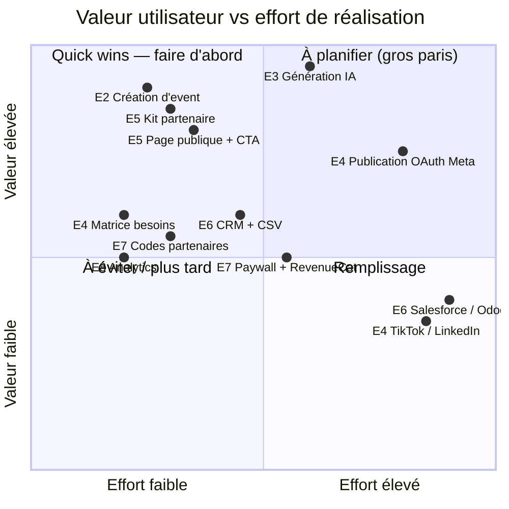

# Flyer — Backlog priorisé

Chaque story est reliée à une **hypothèse** ([01-lean-ux-canvas.md](01-lean-ux-canvas.md)), un **persona** ([02-personas.md](02-personas.md)) et un **sprint** ([06-preparation-sprints.md](06-preparation-sprints.md)). Les points sont en Fibonacci (1, 2, 3, 5, 8). Une story > 8 pts doit être découpée (Definition of Ready, [04-regles-sprints.md](04-regles-sprints.md)).

## Epics

| Epic | Nom | Hypothèses | Personas | MoSCoW |
|---|---|---|---|---|
| **E1** | Authentification & profil entreprise | H0 | Camille, Marc, Ahmed | Must |
| **E2** | Events | H0 | Camille, Marc | Must |
| **E3** | IA & flyers | H1 | Camille, Marc | Must |
| **E4** | Besoins par plateforme & publication | H1 | Camille, Marc, Ahmed | Must (matrice) / Should (OAuth) |
| **E5** | Kit partenaire & page publique | H2, H6 | Sophie, Léa, Camille | Must |
| **E6** | CRM & synchronisation | H4 | Marc, Camille, Léa | Should (CRM, CSV) / Could (Salesforce, Odoo) |
| **E7** | Monétisation & codes partenaires | H3, H5 | Ahmed, Camille, Marc | Should |
| **E8** | Analytics & apprentissage | toutes | Équipe produit | Must (dès S0) |

---

## Matrice valeur / effort



---

## Stories par epic

Format : **ID** — *En tant que [persona], je veux [action] afin de [bénéfice].* — Hypothèse · Points · MoSCoW · Sprint

### E1 — Authentification & profil entreprise

**FL-101** — En tant que Camille, je veux créer un compte et me connecter (email / mot de passe, Apple, Google) afin de retrouver mes events sur tous mes appareils. — H0 · 5 pts · Must · S1
```gherkin
Scénario : inscription par email
  Étant donné que je suis sur l'écran de connexion
  Quand je saisis un email valide et un mot de passe ≥ 8 caractères
  Et que je valide
  Alors un compte Supabase est créé
  Et je suis redirigée vers l'écran « Profil entreprise »
  Et l'événement analytique "sign_up" est émis

Scénario : connexion Apple ou Google
  Étant donné que je suis sur l'écran de connexion
  Quand je choisis « Continuer avec Apple » ou « Continuer avec Google »
  Alors je suis authentifiée sans saisir de mot de passe
```

**FL-102** — En tant que Camille, je veux renseigner mon profil entreprise (nom commercial, SIRET, logo, adresse, téléphone, email pro, site, réseaux sociaux, couleurs) afin qu'il alimente automatiquement mes flyers. — H0 · 5 pts · Must · S1
```gherkin
Scénario : profil minimal
  Étant donné que je viens de m'inscrire
  Quand je renseigne au moins le nom commercial et un moyen de contact
  Alors je peux passer à la création d'un event
  Et l'événement "business_profile_completed" est émis

Scénario : logo et couleurs
  Quand je téléverse un logo (PNG/JPG ≤ 5 Mo) et choisis 2 couleurs
  Alors ils sont stockés dans Supabase Storage et proposés par défaut dans les flyers
```

**FL-103** — En tant que Camille, je veux pouvoir utiliser l'app en lecture de brouillons même hors connexion afin de ne pas perdre ma saisie dans un magasin sans réseau. — H0 · 3 pts · Should · S1

### E2 — Events

**FL-201** — En tant que Camille, je veux créer un event (nom, description, plage de dates, horaires par jour, lieu, enseigne partenaire, tarif, lien de réservation) afin de générer mes supports. — H0 · 8 pts · Must · S1
```gherkin
Scénario : création valide
  Étant donné que mon profil entreprise est complété
  Quand je saisis « Séance photo de Noël », du 14/12 au 14/12, 10h–18h, Zooplus Part-Dieu, 25 €
  Et que je valide
  Alors l'event est enregistré en statut « brouillon »
  Et l'événement "event_created" est émis avec la durée de saisie

Scénario : dates incohérentes
  Quand la date de fin est antérieure à la date de début
  Alors le bouton « Enregistrer » est désactivé et un message explique l'erreur

Scénario : horaires incohérents
  Quand l'heure de fin d'un jour est antérieure ou égale à l'heure de début
  Alors un message d'erreur s'affiche sous le jour concerné
```

**FL-202** — En tant que Camille, je veux voir la liste de mes events (à venir / passés) avec leur statut (brouillon, publié, terminé) afin de savoir où j'en suis. — H0 · 3 pts · Must · S1

**FL-203** — En tant que Camille, je veux que mon brouillon soit sauvegardé automatiquement en local afin de ne rien perdre si je ferme l'app. — H0 · 3 pts · Must · S1

**FL-204** — En tant que Marc, je veux dupliquer un event ou l'enregistrer comme template afin de ne pas ressaisir mes events récurrents. — H1 · 3 pts · Should · S2

**FL-205** — En tant que Camille, je veux recevoir des rappels J-7 et J-2 (notification) avec l'état de mes publications et réservations afin d'agir avant la veille. — H6 · 5 pts · Must · S3
```gherkin
Scénario : rappel J-7
  Étant donné un event publié dont la date de début est dans 7 jours
  Quand il est 9h heure locale
  Alors je reçois une notification « J-7 : 9 réservations · 2 plateformes publiées · kit non ouvert par le magasin »
```

### E3 — IA & flyers

**FL-301** — En tant que Camille, je veux lancer la génération IA d'un event et obtenir 3 propositions de texte adaptées à chaque plateforme afin de choisir rapidement. — H1 · 8 pts · Must · S2
```gherkin
Scénario : génération réussie
  Étant donné un event en brouillon avec profil entreprise complet
  Quand je touche « Générer avec l'IA »
  Alors en moins de 20 s je vois 3 propositions par plateforme (Instagram, Facebook, groupes locaux, affiche A4)
  Et l'événement "flyer_generated" est émis avec la durée et le nombre de propositions

Scénario : quota atteint
  Étant donné que j'ai utilisé mes 5 générations du mois (plan Gratuit)
  Quand je touche « Générer »
  Alors un message explique le quota et propose le plan Pro
  Et l'événement "quota_reached" est émis
```

**FL-302** — En tant que Camille, je veux obtenir au moins 1 visuel de flyer généré (format carré + story + A4) reprenant mon logo et mes couleurs afin de publier sans Canva. — H1 · 8 pts · Must · S2

**FL-303** — En tant que Camille, je veux éditer le texte généré (et régénérer une seule proposition) afin de garder ma voix. — H1 · 3 pts · Must · S2

**FL-304** — En tant que Marc, je veux définir un ton par plateforme (ex. « sobre, sans emoji » pour LinkedIn) afin que l'IA respecte mon positionnement. — H1 · 3 pts · Should · S2

**FL-305** — En tant que Camille, je veux exporter le visuel dans ma galerie et ouvrir le partage natif afin de publier même sans connexion OAuth. — H1 · 3 pts · Must · S2
```gherkin
Scénario : share sheet
  Quand je touche « Partager » sur une proposition
  Alors la share sheet native s'ouvre avec l'image et le texte
  Et l'événement "share_sheet_opened" est émis
```

### E4 — Besoins par plateforme & publication

**FL-401** — En tant que Camille, je veux voir une matrice plateforme × besoin (photo, vidéo, audio, texte) avec un statut (manquant / fourni / généré) afin de ne rien oublier. — H1 · 5 pts · Must · S3
```gherkin
Scénario : matrice initiale
  Étant donné un event avec plateformes Instagram, Facebook, TikTok, affiche A4 sélectionnées
  Quand j'ouvre « Besoins »
  Alors je vois pour TikTok : vidéo = manquant, texte = généré ; pour Instagram : photo = généré, texte = généré
```

**FL-402** — En tant que Camille, je veux fournir un besoin manquant (téléverser une photo/vidéo/audio) ou demander à l'IA de le générer afin de compléter la matrice. — H1 · 5 pts · Must · S3 (émet `need_marked_provided`)

**FL-403** — En tant que Camille, je veux connecter mon compte Meta (Instagram + page Facebook) afin de publier en 1 clic. — H1 · 8 pts · Should · S4
```gherkin
Scénario : connexion OAuth
  Quand je touche « Connecter Instagram / Facebook »
  Alors le flux OAuth Meta s'ouvre et, une fois validé, les tokens sont stockés chiffrés côté serveur
  Et aucun token n'est accessible dans le client
```

**FL-404** — En tant que Camille, je veux publier ou programmer une publication sur les plateformes connectées et voir son statut (programmé, publié, échec) afin de ne pas y revenir. — H1 · 8 pts · Should · S4 (émet `publish_success` / `publish_failed`)

**FL-405** — En tant que Marc, je veux connecter Google Business Profile afin de publier un « post » local. — H1 · 5 pts · Should · S4

**FL-406** — En tant qu'Ahmed, je veux publier sur TikTok et LinkedIn afin de toucher mes communautés. — H1 · 8 pts · Could · S7

### E5 — Kit partenaire & page publique

**FL-501** — En tant que Camille, je veux générer un lien « kit partenaire » et l'envoyer au magasin afin qu'il relaie sans effort. — H2 · 5 pts · Must · S3
```gherkin
Scénario : partage du kit
  Étant donné un event avec au moins une affiche A4 et un post générés
  Quand je touche « Envoyer le kit au magasin »
  Alors un lien public unique est créé et la share sheet s'ouvre
  Et l'événement "partner_kit_shared" est émis
```

**FL-502** — En tant que Sophie, je veux ouvrir le kit sans compte et y trouver l'affiche A4 (PDF), le texte du post à copier, l'image à télécharger, un QR code et une checklist afin de relayer en 2 minutes. — H2 · 8 pts · Must · S3
```gherkin
Scénario : ouverture du kit
  Quand j'ouvre le lien sur mon téléphone
  Alors la page se charge en < 3 s sans inscription
  Et l'événement "partner_kit_opened" est émis et visible par la photographe

Scénario : checklist
  Quand je coche « Affiche imprimée »
  Alors la photographe voit la case cochée dans l'app
```

**FL-503** — En tant que Léa, je veux voir une page publique d'event (date, lieu, prix, visuel, bouton « Réserver ») afin de réserver en 2 clics. — H6 · 5 pts · Must · S3 (émet `booking_clicked`)

**FL-504** — En tant que Léa, je veux réserver via un formulaire ≤ 3 champs (nom, téléphone, animal) avec consentement explicite afin de ne pas créer de compte. — H6 · 5 pts · Must · S3
```gherkin
Scénario : réservation simple
  Quand je saisis mon nom, mon téléphone et le prénom de mon chat, coche le consentement et valide
  Alors un contact est créé dans le CRM de la photographe avec consentement = vrai
  Et je vois une confirmation ; je reçois un rappel J-1

Scénario : lien externe
  Étant donné que la photographe a renseigné un lien de réservation externe (Calendly…)
  Quand je touche « Réserver »
  Alors je suis redirigée vers ce lien et "booking_clicked" est émis
```

### E6 — CRM & synchronisation

**FL-601** — En tant que Camille, je veux une liste de clients (recherche, tags) avec leurs animaux, l'historique d'events et le consentement RGPD afin de les recontacter. — H4 · 8 pts · Should · S5

**FL-602** — En tant que Marc, je veux importer un CSV avec mapping de colonnes afin de récupérer mes 1 800 contacts. — H4 · 5 pts · Should · S5
```gherkin
Scénario : import avec mapping
  Quand je sélectionne un fichier CSV et associe les colonnes nom, email, téléphone, tags
  Alors un aperçu des 5 premières lignes s'affiche
  Et après confirmation, les contacts sont créés sans doublon (email ou téléphone)
  Et "customer_imported" est émis avec le nombre de lignes
```

**FL-603** — En tant que Marc, je veux exporter mes clients en CSV afin que mes données m'appartiennent. — H4 · 2 pts · Should · S5

**FL-604** — En tant que Léa, je veux pouvoir demander la suppression de mes données afin d'exercer mes droits RGPD. — RGPD · 3 pts · Must · S5

**FL-605** — En tant que Marc, je veux synchroniser mes contacts avec Odoo (XML-RPC / clé API) en bidirectionnel afin de ne rien ressaisir. — H4 · 8 pts · Could · S7

**FL-606** — En tant que studio, je veux synchroniser mes contacts avec Salesforce (OAuth) afin d'alimenter mon CRM. — H4 · 8 pts · Could · S7

### E7 — Monétisation & codes partenaires

**FL-701** — En tant qu'éditeur, je veux définir les plans Gratuit / Pro / Studio avec quotas (events/mois, générations IA/mois, plateformes connectées, contacts) appliqués côté serveur afin de monétiser. — H5 · 5 pts · Should · S6

**FL-702** — En tant que Camille, je veux voir un paywall contextuel quand j'atteins un quota afin de comprendre ce que m'apporte Pro. — H5 · 5 pts · Should · S6 (émet `paywall_viewed`, `subscription_started`)

**FL-703** — En tant que Camille, je veux souscrire via l'App Store / Google Play (RevenueCat) afin de payer simplement. — H5 · 8 pts · Should · S6

**FL-704** — En tant qu'Ahmed, je veux saisir un code partenaire afin d'obtenir le plan complet sans carte bancaire. — H3 · 5 pts · Should · S6
```gherkin
Scénario : code valide
  Quand je saisis « AMB-AHMED-2026 » valide et non expiré
  Alors mon plan devient « partner » (= Studio) jusqu'à la date de fin du code
  Et "partner_code_redeemed" est émis

Scénario : code invalide ou épuisé
  Alors un message explicite s'affiche, sans révéler l'existence d'autres codes
```

**FL-705** — En tant qu'éditeur, je veux générer des codes partenaires (durée, nombre d'utilisations, attribution à un ambassadeur) afin de gérer mes partenariats. — H3 · 3 pts · Should · S6

**FL-706** — En tant qu'Ahmed, je veux répondre à un feedback in-app mensuel (non bloquant) et signaler un problème depuis n'importe quel écran afin d'être entendu. — H3 · 3 pts · Should · S6 (émet `feedback_submitted`)

**FL-707** — En tant qu'Ahmed, je veux un code de parrainage afin d'offrir 1 mois Pro à mes filleuls et prolonger mon plan. — H3 · 5 pts · Could · S7

### E8 — Analytics & apprentissage

**FL-801** — En tant qu'équipe produit, je veux un service d'analytics avec les événements Lean UX nommés et typés afin de mesurer chaque hypothèse. — toutes · 3 pts · Must · S0
**FL-802** — En tant qu'équipe produit, je veux un tableau de bord hebdomadaire (Supabase SQL / Metabase) par hypothèse afin de préparer la sprint review. — toutes · 3 pts · Should · S2

---

## MoSCoW — synthèse

| Must | Should | Could | Won't (cette version) |
|---|---|---|---|
| FL-101, 102, 201, 202, 203, 205, 301, 302, 303, 305, 401, 402, 501, 502, 503, 504, 604, 801 | FL-103, 204, 304, 403, 404, 405, 601, 602, 603, 701–706, 802 | FL-406, 605, 606, 707 | Édition avancée de visuel, publication sans validation, compte magasin/client, place de marché |

**Total Must ≈ 95 pts** → ~3 sprints à vélocité 30–35 pts (S1–S3), cohérent avec le MVP du canvas.

---

## Traçabilité hypothèse → stories

| Hypothèse | Stories |
|---|---|
| H0 | FL-101, 102, 103, 201, 202, 203 |
| H1 | FL-204, 301–305, 401–406 |
| H2 | FL-501, 502 |
| H3 | FL-704–707 |
| H4 | FL-601–603, 605, 606 |
| H5 | FL-701–703 |
| H6 | FL-205, 503, 504 |
| RGPD / transversal | FL-604, 801, 802 |
