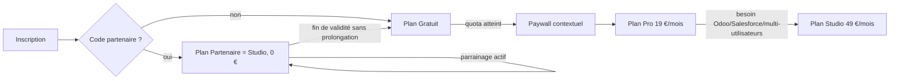
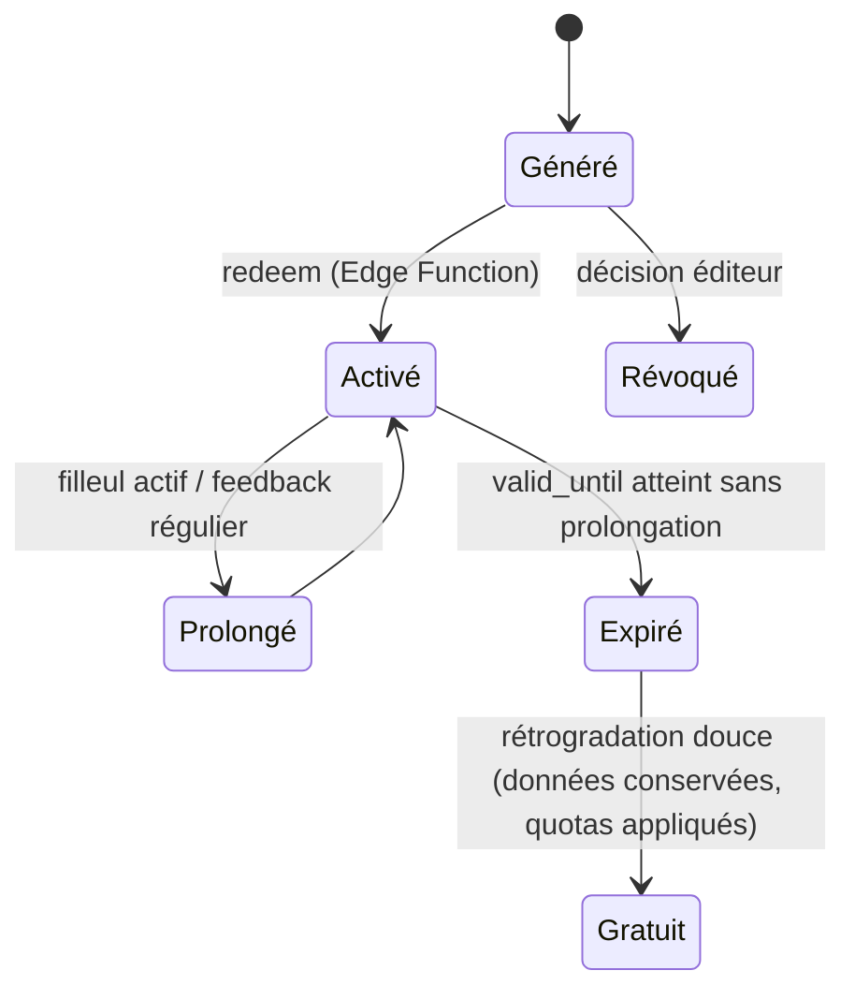

# Flyer — Monétisation

Hypothèses testées : **H5** (conversion Gratuit → Pro ≥ 8 %) et **H3** (codes partenaires → ambassadeurs actifs). Détails techniques dans [07-architecture.md](07-architecture.md), stories FL-701 à FL-707 dans [03-backlog-priorise.md](03-backlog-priorise.md).

## 1. Modèle : freemium + abonnement + codes partenaires

## 2. Plans & quotas

| | **Gratuit** | **Pro** | **Studio** | **Partenaire** |
|---|---|---|---|---|
| Prix indicatif | 0 € | 19 €/mois ou 190 €/an | 49 €/mois ou 490 €/an | 0 € via code |
| Persona cible | Camille (découverte) | Camille, Marc | Marc, studios | Ahmed |
| Events / mois | 1 | Illimité | Illimité | Illimité |
| Générations IA / mois | 5 | 100 | 300 + priorité | 300 |
| Plateformes connectées | 2 | Toutes | Toutes | Toutes |
| Contacts CRM | 50 | 2 000 | Illimité | Illimité |
| Import / export CSV | Export seul | ✅ | ✅ | ✅ |
| Kit partenaire & page publique | ✅ (watermark « Créé avec Flyer ») | ✅ sans watermark | ✅ white-label (domaine perso) | ✅ sans watermark |
| Rappels J-7 / J-2 | ✅ | ✅ | ✅ | ✅ |
| Programmation des publications | ❌ | ✅ | ✅ | ✅ |
| Templates d'event | 1 | Illimité | Illimité | Illimité |
| Sync Salesforce / Odoo | ❌ | ❌ | ✅ | ✅ |
| Multi-utilisateurs | ❌ | ❌ | 5 sièges | 2 sièges |
| Support | Communauté | Email 48 h | Prioritaire 24 h | Canal ambassadeurs |
| Feedback in-app | Optionnel | Optionnel | Optionnel | Mensuel (non bloquant) |

### Principes
- Les quotas sont **appliqués côté serveur** (Edge Functions + RLS, fonction SQL `current_plan(user_id)`), jamais seulement dans l'app.
- Le quota de générations IA protège la marge : coût estimé ≈ 0,02 € par texte et 0,04–0,08 € par image → ≤ 8 € de coût IA pour un Pro utilisant 100 % de son quota.
- Le watermark du Gratuit est le principal déclencheur de conversion attendu (rejeté par Marc → il passe en Pro ; Camille l'accepte pour tester).

## 3. Déclencheurs de paywall (H5)

| Moment | Message | Événement |
|---|---|---|
| 2ᵉ event du mois | « Vous avez utilisé votre event gratuit du mois. Passez en Pro pour des events illimités. » | `quota_reached{kind: events}` |
| 6ᵉ génération IA | « 5 générations utilisées. Pro : 100 / mois. » | `quota_reached{kind: ai}` |
| 3ᵉ plateforme connectée | « Connectez toutes vos plateformes avec Pro. » | `quota_reached{kind: platforms}` |
| Partage du kit avec watermark | « Retirez le watermark avec Pro. » (soft, dismissable) | `paywall_viewed{context: watermark}` |
| 51ᵉ contact | « Votre carnet client est plein. » | `quota_reached{kind: contacts}` |

Règle produit : **le paywall n'interrompt jamais un event en cours de publication** (on bloque la création du suivant, pas la communication du courant). Un essai Pro de 14 jours **sans carte bancaire** est proposé une fois.

## 4. Codes partenaires (H3)

### Objectif
Rendre l'application **entièrement gratuite** pour des photographes partenaires (ambassadeurs, bêta-testeurs, partenariats enseignes), en échange de feedback et de bouche-à-oreille.

### Mécanisme
| Attribut (`partner_codes`) | Description |
|---|---|
| `code` | Format `AMB-<NOM>-<ANNÉE>` ou `ZOO-<MAGASIN>-<ANNÉE>`, insensible à la casse |
| `plan_granted` | `partner` (= Studio) par défaut ; peut être `pro` |
| `valid_from` / `valid_until` | Fenêtre d'utilisation du code |
| `duration_days` | Durée du plan accordé après activation (ex. 365) |
| `max_redemptions` / `redemptions_count` | Nombre d'utilisations (1 pour un ambassadeur nominatif, 50 pour une enseigne) |
| `owner_user_id` | Ambassadeur à qui le code est attribué (parrainage, attribution) |
| `requires_feedback` | Déclenche le feedback mensuel non bloquant |
| `notes` | Contexte du partenariat |

### Cycle de vie

### Règles
- Activation via l'Edge Function `redeem-partner-code` (vérifie validité, compteur, unicité par utilisateur ; écrit dans `subscriptions` avec `source = partner_code`).
- Un utilisateur ne peut avoir qu'un code actif à la fois ; un code partenaire **remplace** un abonnement payant en pause (pas de double facturation).
- **Prolongation automatique** : +3 mois à chaque filleul qui crée ≥ 2 events, ou tous les 3 feedbacks soumis (répond à l'objection d'Ahmed : « si je contribue, je garde l'accès »).
- Rétrogradation **douce** à l'expiration : rien n'est supprimé, les quotas Gratuit s'appliquent aux nouvelles actions.
- Les codes ne sont jamais énumérables depuis le client (réponse générique « code invalide »).

### Parrainage (FL-707, Could)
- Chaque Pro/Studio/Partenaire dispose d'un code `REF-<pseudo>`.
- Filleul : 1 mois Pro offert. Parrain : +1 mois (payant) ou +3 mois (partenaire).

## 5. Offre B2B enseignes

Réponse au verrou identifié chez Sophie (les accès de la page magasin appartiennent au siège) :

| Offre | Contenu | Prix indicatif |
|---|---|---|
| **Enseigne Partenaire** | L'enseigne (ex. Zooplus France) sponsorise le plan Pro de ses photographes animateurs via des codes `ZOO-*`, reçoit un tableau de bord des animations (events, remplissage, relais par magasin) | 290 €/mois par région ou 3 €/event |
| **Kit siège** | Templates à la charte de l'enseigne, publication directe sur les pages locales via le compte Meta Business de l'enseigne | Sur devis |

Valeur pour l'enseigne : animations réussies = trafic en magasin + CA additionnel, et visibilité sur ce que font réellement les magasins.

## 6. Sources complémentaires (à tester plus tard)

| Source | Description | Statut |
|---|---|---|
| Commission sur réservations | 0,50 € par réservation via la page publique Flyer (opt-in, alternative au Pro) | Hypothèse à tester en S6 ; risque d'être perçue comme une taxe |
| Marketplace de templates | Templates premium créés par des designers / photographes, revenu partagé 70/30 | Vague 5+ |
| Tirages & produits | Partenariat labo photo (calendriers, tirages) avec commission | Hors périmètre produit initial |

## 7. Métriques de monétisation

| Métrique | Cible | Événements |
|---|---|---|
| Conversion Gratuit → Pro (30 j) | ≥ 8 % | `quota_reached` → `paywall_viewed` → `subscription_started` |
| Taux d'ouverture du paywall → achat | ≥ 15 % | idem |
| Churn mensuel Pro | ≤ 5 % | RevenueCat webhooks → `subscriptions` |
| Codes partenaires activés → ambassadeurs actifs (≥ 2 events) | ≥ 60 % | `partner_code_redeemed`, `event_created` |
| Feedbacks soumis par ambassadeur / mois | ≥ 1 | `feedback_submitted` |
| Coût IA / utilisateur Pro / mois | ≤ 8 € | Logs Edge Function `generate-content` |

## 8. Implémentation (résumé)

- SDK : **RevenueCat** (`purchases_flutter`) pour App Store + Google Play ; webhooks RevenueCat → Edge Function → table `subscriptions`.
- Le plan effectif est calculé côté serveur : `subscriptions` actives (payantes ou `partner_code`) → sinon `free`.
- Les quotas sont vérifiés dans les Edge Functions (`generate-content`, `publish-*`) et par des politiques RLS / triggers sur `events` et `customers`.
- Écrans : `PaywallPage`, `PartnerCodePage` (feature `billing`).
