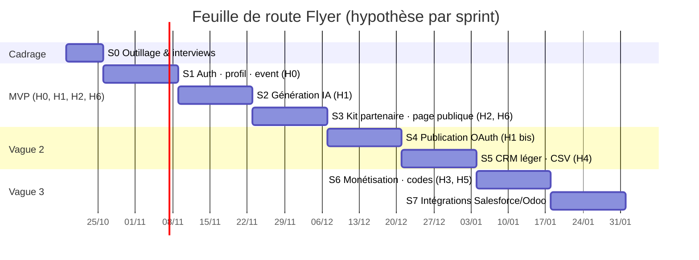

# Flyer — Préparation des sprints S0 → S7

Chaque sprint teste une hypothèse du [Lean UX Canvas](01-lean-ux-canvas.md) avec les stories du [backlog](03-backlog-priorise.md), selon les [règles de sprint](04-regles-sprints.md). Vélocité cible : 30–35 pts.

---

## Sprint 0 — Outillage & cadrage (1 semaine)

| | |
|---|---|
| **Objectif** | Une équipe outillée, un squelette d'app qui compile, 5 interviews réalisées, personas confrontés au terrain. |
| **Hypothèse** | Aucune hypothèse produit ; validation des **proto-personas** (Camille, Marc, Sophie, Léa, Ahmed). |
| **Stories** | FL-801 (analytics, 3 pts) + tâches techniques ci-dessous |

### Contenu
- Projet Supabase `staging` en région EU ; `supabase/migrations/0001_init.sql` appliquée ; buckets Storage `logos`, `flyers`, `kits`.
- Squelette Flutter : dépendances, routing, thème, features placeholder, modèles freezed, tests verts (ce dépôt).
- CI GitHub Actions : `analyze` + `test` + `build_runner`.
- Design tokens (couleurs, typographies, espacements) dans `theme.dart` ; maquettes basse fidélité des écrans S1.
- **5 interviews** de photographes (30 min) : guide d'entretien autour de « raconte-moi ton dernier event en magasin ».
- 1 interview de responsable de magasin (Sophie).

### Critères de succès
- `flutter analyze` 0 erreur, `flutter test` vert, app lancée sur Android + iOS avec écran de connexion placeholder.
- Fiches personas mises à jour avec ≥ 3 verbatims réels chacune.
- Backlog S1 à l'état *Ready*.

### Risques
- Comptes développeur Apple/Google non créés → démarrer la demande dès S0 (délais).
- Difficulté à recruter 5 photographes → réseau de l'amie photographe + groupes Facebook pros.

---

## Sprint 1 — Auth, profil entreprise, création d'event

| | |
|---|---|
| **Objectif** | Un photographe crée son compte, son profil entreprise et un event complet depuis son téléphone. |
| **Hypothèse testée** | **H0** — Camille saisit un event complet en **< 5 min** grâce à la création guidée pré-remplie. |
| **Personas** | Camille, Marc, Ahmed |
| **Stories** | FL-101 (5), FL-102 (5), FL-201 (8), FL-202 (3), FL-203 (3), FL-103 (3) → **27 pts** + 20 % réserve |

### Critères d'acceptation (synthèse)
- Inscription email + Apple + Google ; redirection vers le profil entreprise.
- Profil : nom, SIRET, logo, adresse, téléphone, email, site, réseaux, 2 couleurs.
- Formulaire event avec validation `end_date >= start_date` et horaires cohérents par jour ; brouillon auto-sauvegardé en local ; liste des events avec statut.
- Événements analytiques : `sign_up`, `business_profile_completed`, `event_created{duration_ms}`.

### Métriques de succès
- Temps médian de création d'un event (chrono analytics) **< 5 min** sur ≥ 5 testeurs.
- ≥ 80 % des testeurs terminent sans aide.
- 0 crash sur TestFlight/Internal testing.

### Plan de test utilisateur
- 3 photographes (dont l'amie photographe) : tâche « crée l'event de ta prochaine séance en magasin ». Observation : hésitations sur les horaires par jour, champs jugés inutiles.

### Risques
- Sign in with Apple nécessite un compte développeur actif → fallback email en démo.
- Horaires multi-jours complexes → commencer par « mêmes horaires chaque jour » + exceptions.

---

## Sprint 2 — Génération IA & partage natif

| | |
|---|---|
| **Objectif** | À partir d'un event, obtenir des textes par plateforme et un visuel, les éditer, les partager. |
| **Hypothèse testée** | **H1 (partie IA)** — la génération IA fait passer la communication d'un event de 3 h à 15 min. |
| **Personas** | Camille, Marc |
| **Stories** | FL-301 (8), FL-302 (8), FL-303 (3), FL-305 (3), FL-204 (3), FL-304 (3), FL-802 (3) → **31 pts** |

### Critères d'acceptation (synthèse)
- Edge Function `generate-content` : entrée `{event_id, platforms[], tone?}` → 3 propositions texte / plateforme + visuels carré, story, A4 avec logo et couleurs ; quota vérifié côté serveur ; latence < 20 s.
- Édition et régénération unitaire ; export image en galerie ; share sheet avec image + texte.
- Duplication d'event / template ; ton par plateforme.
- Analytics : `flyer_generated{duration_ms, proposals}`, `share_sheet_opened{platform}`, `quota_reached`.
- Tableau de bord SQL « H1 » (générations / event, partages / event).

### Métriques de succès
- ≥ 80 % des testeurs partagent au moins 1 contenu généré sur un réseau réel.
- Satisfaction qualité texte ≥ 4/5, visuel ≥ 3,5/5.
- Temps « event créé → premier partage » médian ≤ 15 min.

### Plan de test utilisateur
- 3 photographes publient un **vrai** event via share sheet ; questionnaire SUS court + 3 questions ouvertes sur la qualité IA.

### Risques
- Qualité des visuels IA (texte dans l'image illisible) → composer le visuel côté serveur (image de fond IA + texte vectoriel/typo) plutôt que demander du texte à l'IA image.
- Coût → quotas appliqués dès ce sprint, journal de coût par appel.

---

## Sprint 3 — Besoins par plateforme, kit partenaire, page publique, rappels

| | |
|---|---|
| **Objectif** | Le photographe voit ce qui manque par plateforme, envoie un kit au magasin, et les clients réservent via une page publique. |
| **Hypothèses testées** | **H2** — le kit partenaire fait relayer le magasin ; **H6** — page publique + rappels augmentent le remplissage. |
| **Personas** | Camille, Sophie, Léa |
| **Stories** | FL-401 (5), FL-402 (5), FL-501 (5), FL-502 (8), FL-503 (5), FL-504 (5), FL-205 (5) → **38 pts** (⚠️ au-dessus de la vélocité : FL-402 ou FL-205 peut glisser en S4) |

### Critères d'acceptation (synthèse)
- Matrice plateforme × besoin avec statuts ; fourniture d'un asset ou génération IA du besoin manquant.
- Kit partenaire : lien public sans compte, PDF A4, texte à copier, image à télécharger, QR code, checklist avec notification au photographe.
- Page publique `/e/:slug` mobile ; CTA vers lien externe ou formulaire ≤ 3 champs avec consentement ; contact créé dans `customers`.
- Rappels push J-7 / J-2 (photographe) et J-1 (client ayant réservé).
- Analytics : `need_marked_provided`, `partner_kit_shared`, `partner_kit_opened`, `partner_kit_checked`, `booking_clicked`.

### Métriques de succès
- ≥ 50 % des kits envoyés sont ouverts par le magasin ; ≥ 30 % ont ≥ 1 case cochée.
- CTR page publique → réservation ≥ 10 %.
- Verbatim Sophie-like : « je l'ai fait en moins de 5 min ».

### Plan de test utilisateur
- 3 photographes envoient le kit à un vrai magasin ; appel de 10 min avec le responsable 3 jours plus tard (a-t-il imprimé / posté ?).
- Test de la page publique auprès de 5 clients finaux (groupes Facebook).

### Risques
- Magasins injoignables → demander aux photographes d'identifier le contact avant le sprint.
- Flutter Web lourd pour la page publique → mesurer le temps de chargement ; SSR léger si > 3 s.

**Fin du MVP** : revue globale H0, H1 (IA), H2, H6 → décision Persévérer / Pivoter avant la vague 2.

---

## Sprint 4 — Publication automatique

| | |
|---|---|
| **Objectif** | Publier ou programmer en 1 clic sur Instagram, Facebook et Google Business. |
| **Hypothèse testée** | **H1 bis** — la publication 1 clic augmente le nombre de plateformes par event (≥ 3) sans perte de contrôle. |
| **Personas** | Camille, Marc |
| **Stories** | FL-403 (8), FL-404 (8), FL-405 (5) + reliquat S3 → **≈ 26–31 pts** |

### Critères d'acceptation (synthèse)
- OAuth Meta côté serveur, tokens chiffrés ; publication immédiate ou programmée (`pg_cron`) ; statut programmé / publié / échec avec message ; fallback share sheet en cas d'échec.
- Google Business Profile : création d'un post local.
- Analytics : `publish_success{platform}`, `publish_failed{platform, error}`.

### Métriques de succès
- ≥ 90 % de publications réussies ; ≥ 3 plateformes / event sur les events des testeurs.
- Aucun testeur ne désactive la fonction par peur de « publier sans relire ».

### Plan de test utilisateur
- 3 photographes connectent leurs comptes et publient un event réel ; entretien sur la confiance et le besoin de prévisualisation.

### Risques
- **App Review Meta** (permissions `instagram_content_publish`, `pages_manage_posts`) : soumettre dès S2 avec vidéo de démo ; en attendant, tester avec des comptes de test.
- Expiration des tokens → cron de rafraîchissement + statut « reconnecter ».

---

## Sprint 5 — CRM léger & CSV

| | |
|---|---|
| **Objectif** | Gérer sa clientèle, l'importer et l'exporter, respecter le RGPD. |
| **Hypothèse testée** | **H4** — l'import/export CSV couvre 80 % des besoins de synchronisation avant Salesforce/Odoo. |
| **Personas** | Marc, Camille, Léa |
| **Stories** | FL-601 (8), FL-602 (5), FL-603 (2), FL-604 (3) + dette/retours → **18 pts + réserve** (sprint volontairement léger pour absorber les retours du MVP) |

### Critères d'acceptation (synthèse)
- Liste clients (recherche, tags), fiche client avec animaux, historique d'events, consentement ; import CSV avec mapping et dédoublonnage ; export CSV ; suppression des données d'un client (RPC) et suppression de compte.
- Analytics : `customer_imported{rows}`, `customer_exported`, `customer_deleted`.

### Métriques de succès
- ≥ 80 % des testeurs déclarent que CSV suffit « pour l'instant » ; nombre de demandes explicites Salesforce/Odoo consigné.
- Import de 1 800 lignes < 30 s sans doublon.

### Plan de test utilisateur
- Marc-like : import de son export Odoo réel ; Camille-like : retrouver les clientes de son dernier event et les taguer.

### Risques
- CSV hétérogènes (encodage, séparateurs) → détection automatique + aperçu avant import.

---

## Sprint 6 — Monétisation & codes partenaires

| | |
|---|---|
| **Objectif** | Plans, quotas, paywall, achats in-app, codes partenaires, feedback in-app. |
| **Hypothèses testées** | **H5** — conversion Gratuit → Pro ≥ 8 % via paywall contextuel ; **H3** — les codes partenaires créent des ambassadeurs actifs. |
| **Personas** | Camille, Marc, Ahmed |
| **Stories** | FL-701 (5), FL-702 (5), FL-703 (8), FL-704 (5), FL-705 (3), FL-706 (3) → **29 pts** |

### Critères d'acceptation (synthèse)
- `current_plan()` côté serveur, quotas appliqués dans les Edge Functions et par triggers ; paywall contextuel sur quota atteint ; essai Pro 14 jours sans CB (une fois).
- RevenueCat : offres Pro/Studio mensuel et annuel, webhooks → `subscriptions`, restauration d'achats.
- Code partenaire : saisie, validation serveur, plan `partner`, prolongation ; back-office minimal (SQL / Supabase Studio) pour générer les codes.
- Feedback mensuel non bloquant + bouton « signaler » global.
- Analytics : `quota_reached`, `paywall_viewed`, `subscription_started`, `partner_code_redeemed`, `feedback_submitted`.

### Métriques de succès
- Sur la cohorte bêta : conversion paywall → achat ≥ 15 %, Gratuit → Pro ≥ 8 % à 30 jours.
- ≥ 60 % des codes partenaires activés créent ≥ 2 events dans le mois ; ≥ 1 feedback / ambassadeur / mois.

### Plan de test utilisateur
- 10 ambassadeurs (réseau Ahmed-like) reçoivent un code ; 20 utilisateurs Gratuit observés sur 30 jours ; entretiens prix (Van Westendorp simplifié) avec 5 photographes.

### Risques
- Validation des achats in-app par Apple/Google → soumettre les produits dès S5.
- Perception négative du watermark → mesurer le churn Gratuit avant de durcir.

---

## Sprint 7 — Intégrations avancées

| | |
|---|---|
| **Objectif** | Connecteurs Salesforce et Odoo, TikTok/LinkedIn, parrainage, multi-utilisateurs Studio. |
| **Hypothèse testée** | **H4 (suite)** — les connecteurs natifs justifient le plan Studio pour les studios établis ; **H3 (suite)** — le parrainage amplifie l'acquisition. |
| **Personas** | Marc, Ahmed |
| **Stories** | FL-605 (8), FL-606 (8), FL-406 (8), FL-707 (5) → **29 pts** (sélection selon les demandes mesurées en S5/S6 ; un connecteur peut être reporté) |

### Critères d'acceptation (synthèse)
- `sync-crm` avec adaptateurs Odoo (XML-RPC) et Salesforce (OAuth) ; synchro bidirectionnelle contacts, journal de conflits ; statut `last_sync_at`.
- Publication TikTok et LinkedIn via Edge Functions dédiées.
- Parrainage : code `REF-*`, avantages filleul/parrain ; multi-utilisateurs Studio (invitations, rôles).
- Analytics : `crm_synced{provider, pushed, pulled}`, `referral_redeemed`.

### Métriques de succès
- ≥ 3 studios Studio actifs avec synchro sans erreur sur 2 semaines.
- ≥ 20 % des nouveaux inscrits viennent d'un code de parrainage.

### Plan de test utilisateur
- 2 utilisateurs Odoo réels, 1 Salesforce (sandbox) ; revue des conflits de données avec eux.

### Risques
- Diversité des instances Odoo (versions, champs custom) → mapping configurable minimal ; commencer par Odoo 17 SaaS.
- Quotas API Salesforce → synchro incrémentale.

---

## Traçabilité sprint → hypothèse → stories → personas

| Sprint | Hypothèse(s) | Stories | Personas | Métrique clé |
|---|---|---|---|---|
| S0 | Proto-personas | FL-801 | Tous | 5 interviews, squelette vert |
| S1 | H0 | FL-101, 102, 103, 201, 202, 203 | Camille, Marc, Ahmed | Event créé < 5 min |
| S2 | H1 (IA) | FL-204, 301, 302, 303, 304, 305, 802 | Camille, Marc | ≥ 80 % partagent du contenu généré |
| S3 | H2, H6 | FL-205, 401, 402, 501, 502, 503, 504 | Camille, Sophie, Léa | Kits ouverts ≥ 50 %, CTR ≥ 10 % |
| S4 | H1 bis | FL-403, 404, 405 | Camille, Marc | ≥ 3 plateformes / event |
| S5 | H4 | FL-601, 602, 603, 604 | Marc, Camille, Léa | CSV suffit à ≥ 80 % |
| S6 | H3, H5 | FL-701–706 | Camille, Marc, Ahmed | Conversion ≥ 8 %, ambassadeurs actifs ≥ 60 % |
| S7 | H3, H4 (suite) | FL-406, 605, 606, 707 | Marc, Ahmed | Studios actifs, parrainage ≥ 20 % |

Toutes les stories Must du backlog sont couvertes par S0–S3 (sauf FL-604, suppression RGPD, planifiée en S5 avec le CRM) ; toutes les Should par S4–S6 ; les Could par S7.
