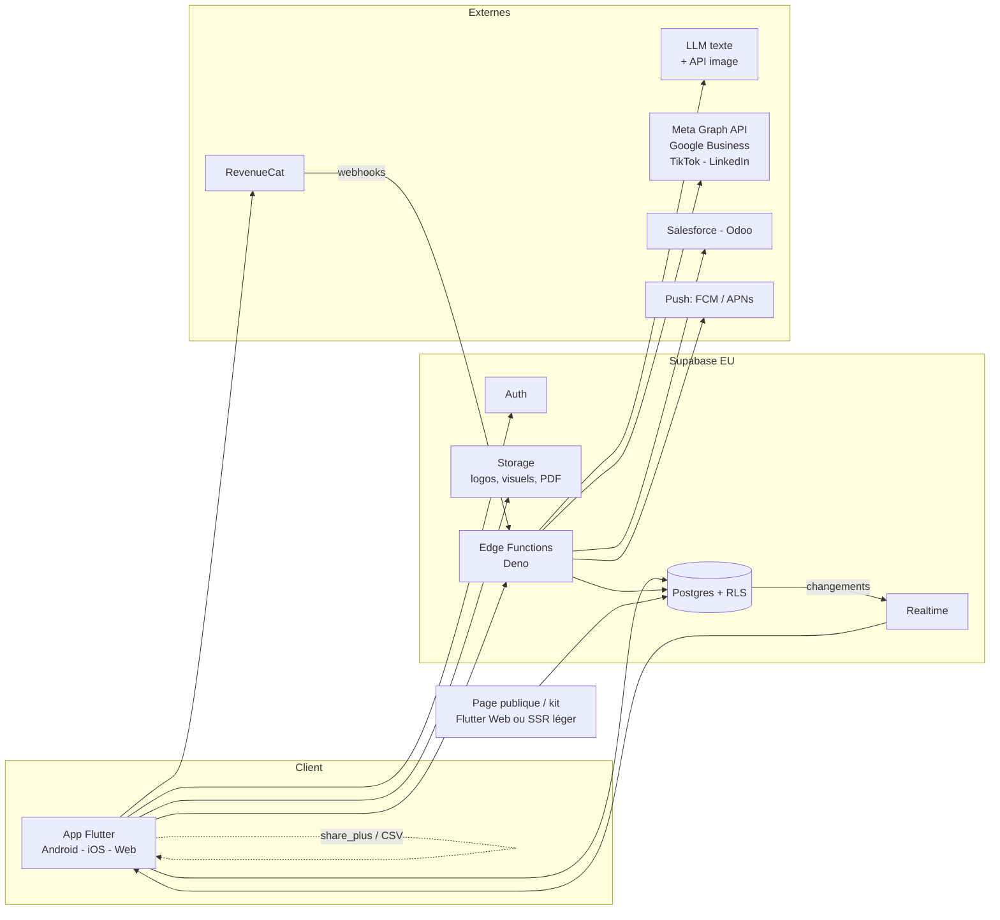
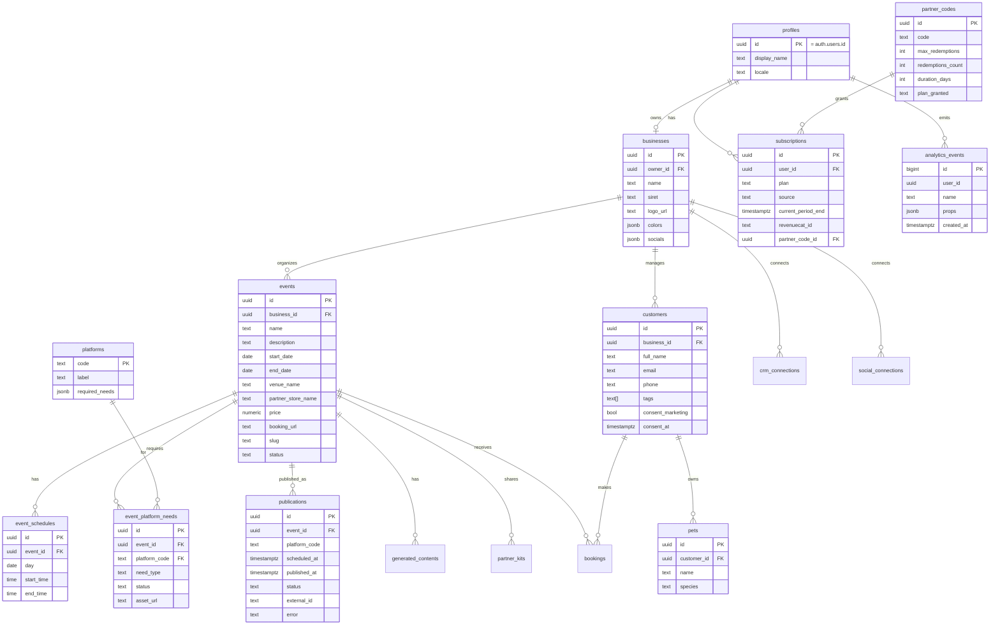
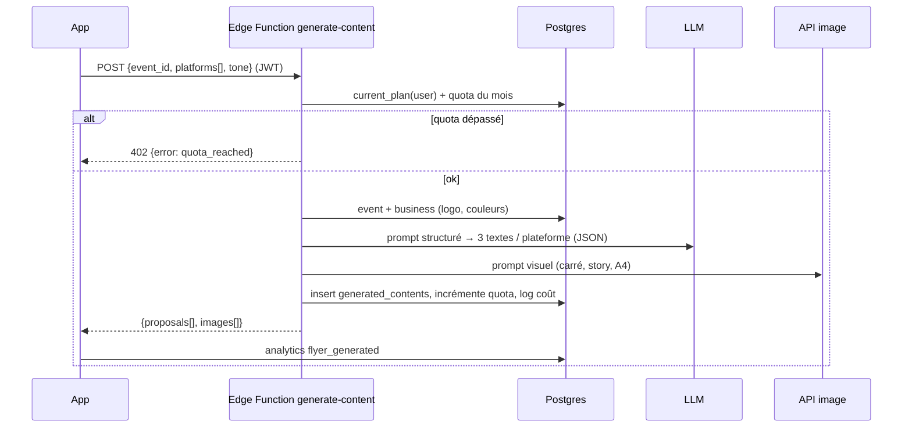
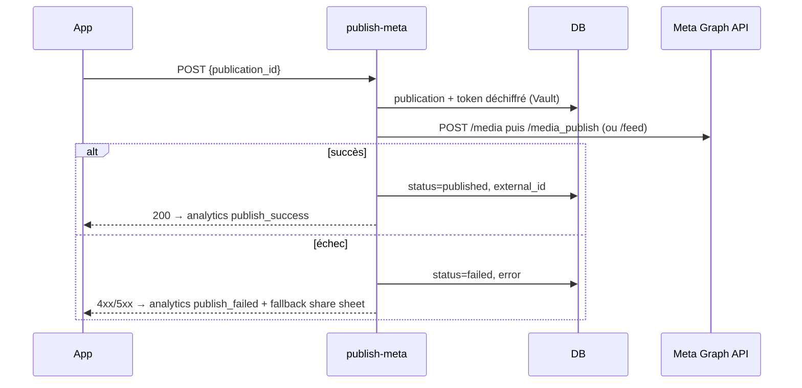

# Flyer — Architecture technique

Décision validée : **Flutter + Supabase (région EU) + Edge Functions**. Le client Flutter ne détient **aucune** clé IA, réseau social ou CRM : tout secret vit dans les Edge Functions.

## 1. Vue d'ensemble



## 2. Stack & choix

| Couche | Choix | Raison |
|---|---|---|
| UI | Flutter 3.32 / Dart 3.8, Material 3 | Android + iOS + Web (page publique, kit) avec une base de code |
| État | `flutter_riverpod` + `riverpod_annotation` | Testable, injection de dépendances, génération de code |
| Navigation | `go_router` | Deep links (`/e/:slug`, `/kit/:token`), redirection auth |
| Modèles | `freezed` + `json_serializable` | Immutabilité, (dé)sérialisation Postgres ↔ Dart |
| Backend | Supabase : Auth, Postgres, Storage, Edge Functions, Realtime | RGPD (eu-central), RLS natif, coûts prévisibles |
| IA | Edge Function `generate-content` → LLM (texte) + API image | Clés côté serveur, quotas par plan, journalisation des coûts |
| Publication | Edge Functions `publish-meta`, `publish-google` (puis TikTok, LinkedIn) ; fallback `share_plus` | OAuth serveur, tokens chiffrés (`pgsodium`/Vault) |
| CRM | Import/export CSV côté client (`csv`, `file_picker`) ; `sync-crm` (Salesforce, Odoo) côté serveur | Secrets isolés, logique commune d'adaptateur |
| Paiement | `purchases_flutter` (RevenueCat) + webhooks → `subscriptions` | Un SDK pour Apple/Google, codes partenaires sans paiement |
| Config | `flutter_dotenv` (`.env` non versionné) | URL / clé anon Supabase ; l'app tolère l'absence de config |
| Notifications | Supabase cron (`pg_cron`) → Edge Function `send-reminders` → FCM/APNs | Rappels J-7 / J-2 / J-1 |
| Qualité | `flutter_lints`, `flutter analyze`, `flutter test`, `mocktail` | DoD ([04-regles-sprints.md](04-regles-sprints.md)) |

## 3. Structure du code Flutter

```
lib/
  main.dart                 # chargement .env, init Supabase tolérante, ProviderScope
  app/
    app.dart                # MaterialApp.router
    router.dart             # go_router : routes + redirection auth
    theme.dart              # design tokens
  core/
    supabase/supabase_client.dart     # accès client + état « configuré / non configuré »
    analytics/analytics_service.dart  # événements Lean UX typés
    widgets/                          # PlaceholderPage, etc.
  features/<feature>/
    data/          # repositories Supabase, DTO
    domain/        # modèles freezed, règles métier (validation)
    presentation/  # pages, widgets, providers Riverpod
```

Features : `auth`, `business_profile`, `events`, `ai_content`, `publishing`, `partner_kit`, `crm`, `billing`.

## 4. Modèle de données (Postgres)



Tables complémentaires : `generated_contents` (propositions IA), `partner_kits` (token public, checklist), `bookings`, `social_connections` (tokens chiffrés), `crm_connections` (Salesforce / Odoo), `feedbacks`.

### Sécurité des données
- **RLS activée sur toutes les tables** : un utilisateur ne voit que les lignes de son `business`.
- Les tables publiques (`events` publiés, `partner_kits`) ne sont jamais lues directement par un anonyme : la **RPC** `get_public_event(slug)` (SECURITY DEFINER, colonnes publiques uniquement) et les RPC `kit_check` / `create_booking` sont les seuls points d'accès `anon`. Les autres fonctions SECURITY DEFINER (`is_business_member`, `current_plan`, triggers) sont révoquées pour `anon` / `PUBLIC`.
- Les policies utilisent `(select auth.uid())` et un rôle explicite (`to authenticated`) ; `supabase db advisors --linked` ne doit remonter aucune erreur avant chaque release.
- **Storage** : buckets `logos` (public, logos affichés sur la page publique et le kit), `flyers` et `kits` (privés, servis par URLs signées). Chemin `<business_id>/<fichier>` ; policies `storage.objects` limitées aux membres via `public.is_business_member(public.storage_business_id(name))`, types MIME et tailles bornés par bucket.
- `social_connections.access_token` et `crm_connections.secret` chiffrés via Vault ; déchiffrés uniquement dans les Edge Functions (service role).
- `analytics_events` : insertion autorisée pour l'utilisateur, lecture réservée au service role (dashboards).

## 5. Flux principaux

### 5.1 Génération IA



### 5.2 Publication



Publications programmées : `pg_cron` toutes les 5 min → appelle `publish-*` pour les `publications` dont `scheduled_at <= now()` et `status = scheduled`.

### 5.3 Kit partenaire & page publique
- `partner_kits.token` (UUID) → URL `https://app.flyer.fr/kit/<token>` (Flutter Web) : affiche PDF (Storage, URL signée longue durée), post à copier, QR vers `/e/<slug>`, checklist (écriture anonyme limitée aux colonnes `checked_*` via RPC `kit_check(token, item)`).
- `/e/<slug>` → RPC `get_public_event(slug)` ; CTA → `booking_url` externe ou RPC `create_booking(slug, name, phone, pet, consent)` qui crée `customers` + `bookings` + analytics `booking_clicked`.

### 5.4 Synchronisation CRM
- **CSV** : parsing côté client (`csv`), mapping colonnes, dédoublonnage (email / téléphone) puis `upsert` par lots de 500.
- **Salesforce** (OAuth 2.0 web server flow) et **Odoo** (XML-RPC, clé API) : Edge Function `sync-crm` avec interface commune `CrmAdapter { pull(), push(), mapContact() }` ; état de synchro dans `crm_connections.last_sync_at`, conflits résolus « dernier écrit gagne » avec journal.

### 5.5 Monétisation
- Achat in-app → RevenueCat → webhook `revenuecat-webhook` → `subscriptions`.
- Code partenaire → `redeem-partner-code` → `subscriptions (source = partner_code)`.
- `current_plan(user_id)` (fonction SQL `security definer`) utilisée par RLS, triggers de quota et Edge Functions.

## 6. Analytics

Service unique `AnalyticsService.track(AnalyticsEvent)` → insertion dans `analytics_events` (fallback : log console en mode non configuré). Noms d'événements figés dans un `enum` Dart pour garantir la traçabilité avec [01-lean-ux-canvas.md](01-lean-ux-canvas.md). Tableaux de bord SQL par hypothèse (vues `kpi_*`).

## 7. RGPD & conformité

| Exigence | Réponse |
|---|---|
| Hébergement UE | Projet Supabase `eu-central-1` (Francfort) ; LLM/image : fournisseurs avec option EU ou pas de données personnelles dans les prompts (prénoms de clients jamais envoyés) |
| Base légale | Consentement explicite (`consent_marketing`, case non pré-cochée) pour la relance ; exécution du contrat pour la réservation |
| Droits | Export CSV, suppression (RPC `delete_customer_data`), suppression de compte (cascade) |
| Minimisation | Formulaire public ≤ 3 champs ; pas de collecte d'adresse |
| Sécurité | RLS, tokens chiffrés, HTTPS, secrets uniquement côté Edge Functions, logs sans PII |
| Sous-traitants | Registre : Supabase, RevenueCat, fournisseur LLM/image, Meta/Google (publication), FCM/APNs |

## 8. Environnements & CI

| Env | Supabase | App |
|---|---|---|
| `local` | `supabase start` (Docker) | `.env` local |
| `staging` | Projet EU dédié | TestFlight / Internal testing |
| `prod` | Projet EU dédié, backups quotidiens | Stores |

CI (GitHub Actions) : `flutter pub get` → `dart run build_runner build` → `flutter analyze` → `flutter test` → `supabase db lint` ; déploiement des Edge Functions via `supabase functions deploy` sur tag.

## 9. Risques techniques & parades

| Risque | Parade |
|---|---|
| App Review Meta / TikTok long | Share sheet dès S2, kit partenaire S3 ; OAuth en S4 seulement |
| Coût / latence IA | Quotas serveur, cache des prompts, génération texte avant image, streaming optionnel |
| Tokens sociaux expirés | Rafraîchissement proactif par cron, statut « reconnecter » dans l'app |
| Flutter Web pour page publique (SEO, poids) | Option SSR léger (Edge Function HTML) si CTR insuffisant |
| Comptes développeur Apple/Google requis pour RevenueCat | Placeholder `billing` en S0, réel en S6 |
