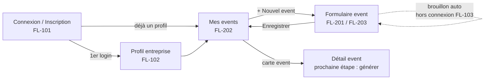

# 08 — Design tokens & maquettes basse fidélité du Sprint 1

Livrable Sprint 0 (voir `06-preparation-sprints.md`). Les tokens sont implémentés dans `lib/app/theme.dart` ; les maquettes couvrent les stories **FL-101, FL-102, FL-201, FL-202, FL-203, FL-103** (hypothèse **H0** : Camille crée un event complet en < 5 min).

## 1. Design tokens

### Couleurs de marque
| Token | Valeur | Usage |
|---|---|---|
| `FlyerColors.primary` | `#E8632B` orange flash | CTA principal, accent, seed Material 3 |
| `FlyerColors.secondary` | `#1F5F5B` vert profond | Titres secondaires, en-têtes de kit partenaire |
| `FlyerColors.tertiary` | `#F2B33D` jaune doré | Badges « Pro », mises en avant |
| `FlyerColors.surface` | `#FFFBF7` | Fond chaud (mode clair) |
| `FlyerColors.ink` | `#1D1B19` | Texte principal |

### Couleurs sémantiques (`Theme.of(context).semantic`)
| Token | Clair | Sombre | Statuts |
|---|---|---|---|
| `success` | `#2E8B57` | `#6CCB8E` | besoin **fourni**, publication **publiée**, event **publié** |
| `warning` | `#D98E04` | `#F2B33D` | besoin **généré (à relire)**, publication **programmée** |
| `danger` | `#C63C2E` | `#F0776A` | besoin **manquant**, publication **échouée** |
| `neutral` | `#8A8580` | `#B5AFA9` | event **brouillon** / **archivé**, texte secondaire |

### Espacements, rayons, durées
| Famille | Tokens |
|---|---|
| `FlyerSpacing` | `xs 4` · `sm 8` · `md 16` · `lg 24` · `xl 32` · `xxl 48` · `touchTarget 48` |
| `FlyerRadius` | `sm 8` (chips de saisie) · `md 12` (champs, boutons) · `lg 16` (cartes) · `pill` (filtres, badges) |
| `FlyerDurations` | `fast 150 ms` (feedback tactile) · `normal 250 ms` (transitions) |

### Typographie (`FlyerTypography.textTheme`)
| Style | Taille / graisse | Usage |
|---|---|---|
| `displaySmall` | 36 / 700 | Titre du flyer A4 (rendu serveur) |
| `headlineMedium` | 28 / 700 | Titre d'écran d'accueil (« Bonjour Camille ») |
| `headlineSmall` | 24 / 600 | Titres de page |
| `titleLarge` / `titleMedium` | 20 / 16 — 600 | Titres de cartes, sections de formulaire |
| `bodyLarge` / `bodyMedium` | 16 / 14 | Corps, descriptions |
| `labelLarge` / `labelSmall` | 14 / 11 | Boutons, badges de statut |

Règles : police système (SF / Roboto) tant que la marque n'est pas figée ; contraste AA minimum (le `primary` sur blanc passe pour les textes ≥ 18 px et les icônes ; utiliser `onPrimary` pour le texte sur fond orange) ; zones tactiles ≥ 48 px ; **une seule action primaire par écran**.

## 2. Principes d'interface (issus des personas)
- **Camille** travaille debout, dans un magasin bruyant, à une main → formulaires en une colonne, gros CTA en bas, pas de double-tap.
- **Marc** veut aller vite → pré-remplissage depuis le profil entreprise et le dernier event, champs optionnels repliés.
- **Ahmed** teste sans carte → aucun paywall avant le premier event ; champ « code partenaire » accessible dès l'inscription.
- Chaque écran répond à une question : *« Qu'est-ce que je dois faire maintenant ? »* (bandeau d'étape suivante).

## 3. Parcours S1



## 4. Maquettes basse fidélité

### 4.1 Connexion / Inscription — FL-101
```
┌──────────────────────────────┐
│          ◉ Flyer             │  headlineMedium
│  Remplissez vos séances      │  bodyLarge, neutral
│                              │
│  [ Email                   ] │
│  [ Mot de passe        👁  ] │
│                              │
│  ┏━━━━━━━━━━━━━━━━━━━━━━━━┓  │  FilledButton primary
│  ┃      Se connecter       ┃  │
│  ┗━━━━━━━━━━━━━━━━━━━━━━━━┛  │
│  Mot de passe oublié ?       │  TextButton
│  ───────── ou ─────────      │
│  [  Continuer avec Apple  ] │  OutlinedButton (iOS en 1er)
│  [ Continuer avec Google  ] │
│                              │
│  Pas de compte ? S'inscrire  │
│  J'ai un code partenaire ›   │  labelLarge, secondary
└──────────────────────────────┘
```
Écran d'inscription identique + champ « Prénom / nom affiché » + case RGPD « J'accepte les CGU et la politique de confidentialité ». Erreurs inline sous le champ, jamais en popup. Analytics : `sign_up{method}`.

### 4.2 Profil entreprise — FL-102 (1er login, puis Réglages)
```
┌──────────────────────────────┐
│ ‹  Votre entreprise   1/2    │  étape « avant votre 1er event »
│                              │
│   ┌──────┐                   │
│   │ logo │  Ajouter un logo  │  bucket `logos`, 2 Mo max
│   └──────┘  (PNG, JPG, SVG)  │
│                              │
│  [ Nom commercial *        ] │
│  [ Téléphone *             ] │
│  [ Email pro               ] │  pré-rempli (compte)
│  [ Ville / adresse         ] │
│                              │
│  ▸ Plus d'infos (optionnel)  │  replié : SIRET, site, Instagram,
│                              │  Facebook, TikTok
│  Couleurs de marque          │
│   (●) #E8632B  (●) #1F5F5B  │  2 pastilles, color picker simple
│                              │
│  ┏━━━━━━━━━━━━━━━━━━━━━━━━┓  │
│  ┃ Enregistrer et continuer┃  │
│  ┗━━━━━━━━━━━━━━━━━━━━━━━━┛  │
│  Passer pour l'instant       │  TextButton (profil minimal = nom + tél)
└──────────────────────────────┘
```
Analytics : `business_profile_completed{fields_count, has_logo}`.

### 4.3 Mes events — FL-202
```
┌──────────────────────────────┐
│ Bonjour Camille          ⚙   │  headlineMedium
│ ┌──────────────────────────┐ │
│ │ ⚠ 2 events sans flyer    │ │  bandeau « prochaine étape » (warning)
│ └──────────────────────────┘ │
│ (À venir) (Passés)           │  SegmentedButton
│                              │
│ ┌──────────────────────────┐ │  Card lg
│ │ Séance photo chiens      │ │  titleLarge
│ │ Zooplus Lyon Part-Dieu   │ │  bodyMedium neutral
│ │ 14 → 15 nov · 10h–18h    │ │
│ │ ● Brouillon              │ │  badge neutral / success « Publié »
│ └──────────────────────────┘ │
│ ┌──────────────────────────┐ │
│ │ Chats de Noël — Maxi Zoo │ │
│ │ 6 déc · 10h–17h          │ │
│ │ ● Publié · 3 plateformes │ │
│ └──────────────────────────┘ │
│                              │
│                   ╭────────╮ │
│                   │ + Event│ │  FAB étendu primary
│                   ╰────────╯ │
└──────────────────────────────┘
```
État vide : illustration + « Créez votre premier event en 5 min » + CTA. Ordre : date de début croissante (à venir), décroissante (passés).

### 4.4 Nouvel event — FL-201 / FL-203
Formulaire en **3 sections sur un seul écran scrollable** (pas de wizard : Camille veut voir le tout).
```
┌──────────────────────────────┐
│ ‹  Nouvel event   ✓ Brouillon│  « Brouillon enregistré 10:42 » (FL-203)
│                              │
│ L'ESSENTIEL                  │  titleMedium secondary
│  [ Nom de l'event *        ] │  ex. « Séance photo chiens & chats »
│  [ Enseigne / magasin      ] │  autocomplete : Zooplus, Maxi Zoo, Animalis…
│  [ Lieu (ville, adresse)   ] │
│                              │
│ DATES & HORAIRES             │
│  [ Du  14/11 ]  [ Au 15/11 ] │  DateRangePicker ; erreur si fin < début
│  ☑ Mêmes horaires chaque jour│
│  [ 10:00 ]  →  [ 18:00 ]     │  erreur si fin ≤ début
│  ▸ Horaires par jour         │  si décoché : 1 ligne / jour
│                              │
│ POUR VOS CLIENTS             │
│  [ Description             ] │  multi-lignes, compteur 300 car.
│  [ Tarif (€)  ] [ Lien résa ]│  optionnels
│                              │
│  ┏━━━━━━━━━━━━━━━━━━━━━━━━┓  │  sticky en bas
│  ┃   Enregistrer l'event   ┃  │
│  ┗━━━━━━━━━━━━━━━━━━━━━━━━┛  │
└──────────────────────────────┘
```
Règles : validation à la perte de focus et à la soumission (`Event.validate()` du domaine) ; brouillon local écrit à chaque changement (debounce 500 ms) ; hors connexion (FL-103) → bandeau neutre « Hors ligne — votre brouillon est conservé sur ce téléphone », synchro au retour réseau. Analytics : `event_created{duration_ms, schedules_count, has_booking_url}` (chrono démarré à l'ouverture du formulaire).

### 4.5 Détail event (fin de S1, sert de pont vers S2)
```
┌──────────────────────────────┐
│ ‹  Séance photo chiens    ⋯  │
│  Zooplus Lyon · 14→15 nov    │
│  ● Brouillon                 │
│                              │
│ PROCHAINE ÉTAPE              │
│ ┌──────────────────────────┐ │
│ │ ✨ Générer mes flyers    │ │  désactivé en S1 : « disponible bientôt »
│ └──────────────────────────┘ │
│  Modifier l'event            │
│  Supprimer                   │  confirmation
└──────────────────────────────┘
```

## 5. Checklist « Ready » du backlog S1
| Story | Hypothèse | Persona | Gherkin (03) | Maquette (ci-dessus) | Analytics | Points |
|---|---|---|---|---|---|---|
| FL-101 | H0 | Camille, Ahmed | ✅ | 4.1 | `sign_up` | 5 |
| FL-102 | H0 | Camille, Marc | ✅ | 4.2 | `business_profile_completed` | 5 |
| FL-201 | H0 | Camille | ✅ | 4.4 | `event_created` | 8 |
| FL-202 | H0 | Camille | ✅ | 4.3 | — | 3 |
| FL-203 | H0 | Camille | ✅ | 4.4 | — | 3 |
| FL-103 | H0 | Camille | ✅ | 4.4 (bandeau) | — | 3 |

**Total 27 pts** — toutes les stories satisfont la Definition of Ready (`04-regles-sprints.md`). Les maquettes seront confrontées aux 5 interviews (`09-guide-entretiens.md`) avant le planning S1.
